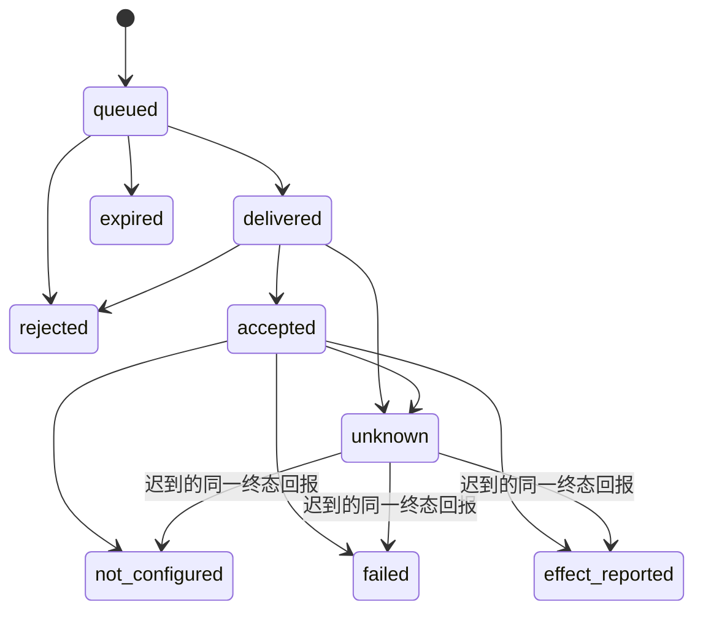

# 设备管理协议 v1 与本地参考实现

这是与实现语言无关的消息/状态约定，以及验证它的 Node 参考代码。业务后端设计采用 Java／Spring Boot＋MySQL；原生与 Agent 按系统集成需要选择技术，详见[开发交接](../../docs/design/README.md)。参考代码在 Node 22.22.2 上验证，使用内置 `node:sqlite`；该 Node 版本会显示 SQLite 实验性 API 提示。没有引入第三方包。

## 运行与覆盖范围

```powershell
node backend/device-health/reference-demo.cjs
node --test backend/device-health/health-contract.test.cjs backend/device-health/reference-runtime.test.cjs
```

Demo 为虚构设备在临时目录创建两个 SQLite 日志，启动一个 `127.0.0.1` 随机端口，生成仅在内存中的临时设备密钥/运营 token，进行握手、心跳、命令下发与结果回报，随后退出。它明确使用 `reference-fixture-boot`，没有采集本机身份，没有安装服务，没有重启电脑。实际终态是 `not_configured`，输出 `actualDeviceActionsExecuted: false`。临时日志不含设备 HMAC 密钥或运营 token，但有会话令牌和参考消息，应按开发数据管理。

`ReferenceControl` 默认没有任何设备或身份配置；未知设备与未认证请求全部拒绝。`ReferenceAgent` 只能执行代码中注入的固定执行器接口；默认执行器返回 `RECOVERY_EXECUTOR_NOT_CONFIGURED`。没有 shell、传入命令字符串、自动安装、真实电源/网络/镜像操作。仅本地示例可用，不能把回环 HTTP 改成公网监听后直接上线。

## 身份与消息封装

每台设备预置不同密钥，不共用全平台设备密钥。生产建议设备独立密钥对/证书、mTLS、密钥轮换和吊销；本参考使用 HMAC-SHA256 验证请求与应答，用于本地协议验证。运维主账号 token 与设备密钥分离。

```json
{
  "version": 1,
  "deviceId": "registered-device-id",
  "route": "heartbeat",
  "issuedAt": 1800000000000,
  "nonce": "32-lowercase-hex-characters",
  "replyTo": null,
  "payload": {},
  "signature": "64-lowercase-hex-characters"
}
```

签名涵盖除 `signature` 外的全部字段，包含消息用途 `route`，禁止把心跳重放成执行请求。应答 `replyTo` 必须等于请求 nonce，且应答同样签名。时间窗为 ±30 秒，nonce 在服务端 SQLite 中至少保留 60 秒，重复请求封装拒绝。重试应用请求时必须生成新 nonce，业务去重由 command ID、握手 ID 或序列完成。

参考签名编码约定为 UTF-8 JSON：对象键只允许可打印 ASCII 并按字典顺序递归排序；数组保持顺序；数字只允许安全整数；布尔/null 按 JSON 表示；字符串使用 JSON 字符串转义，不把中文额外转成 ASCII 转义。无空白，签名输出小写 hex。不能原样移植不同语言的默认 JSON 编码后假设签名一致；生产协议落定时应确定标准规范化算法并加入跨语言测试向量。

设备握手上报 OS `bootId`、本次进程 `agentInstanceId`、持久化的 `handshakeId` 与上一会话 token。首次由预置设备身份建立会话；之后只有持有当前 token 才能换会话。服务端生成新 token，旧会话立即失效。握手 ID 幂等，丢失应答时能恢复同一握手结果；Agent 将待完成握手先写盘，进程重启后先取回结果，再轮换到新的进程身份。丢失设备本地状态/凭据时需要受审计重新接入，不能放宽成无条件接管。

心跳绑定会话 token；OS/Agent 启动身份必须与该会话一致。`sequence` 在同一会话中严格递增；服务端覆盖设备发送的 `deviceId` 与 `serverReceivedAt`，不能让设备自报时间续命。真正 OS boot identity 与进程采样需由未来的只读采集器提供，Demo 的虚构数据不能成为生产观测。

供应商硬件归属与客户租期身份分开：库存应有 `supplierId/supplierMachineRef`，分配另有 `tenantId/assignedAccountId/assignmentVersion`。设备不能自行修改供应商、租户或分配；supplier 身份不在恢复动作的默认授权角色中。供应商所有权不能自动赋予客户桌面、账号、文件或重启权限。

HMAC 只能证明消息持有设备密钥。客户拥有 OS 管理员/root 权限时，可以读取/停掉 Agent 或伪造自己设备的观测，因此机内心跳不是强硬件证明，也不能单独作为到期隔离、完整擦盘或重新交付的依据。

## 参考端点

全部 Agent 端点使用 `POST /agent/v1/{route}`，请求和成功应答都是签名封装：

| route | payload | 服务端行为 |
| --- | --- | --- |
| `session` | `bootId, agentInstanceId, handshakeId, previousSessionToken` | 验证设备身份和上一会话，返回新的 `sessionToken` |
| `heartbeat` | `sessionToken, heartbeat` | 校验当前会话和递增序列，保存服务端接收时间与健康状态 |
| `commands` | `sessionToken` | 返回至多一个未过期命令、随机 `deliveryToken` 和执行超时；没有命令返回 null |
| `results` | `sessionToken, commandId, deliveryToken, result` | 验证目标和交付凭据，持久化接单或终态，完全相同终态回报幂等 |

参考内部控制端点仅接受配置中有对应运营身份的 Bearer token：`POST /internal/v1/recovery-commands` 接受 `{ deviceId, request }`，`POST /internal/v1/recovery-operation` 接受 `{ commandId }`。账号/权限从服务端 token 配置获得，不能在 body 中指定。此简化认证不替代未来实际登录、会话、CSRF、审计审批或短时一次性中断确认令牌。

客户控制台仍应使用独立业务入口，验证主账号/子账号分配后转入控制面；本参考没有开放客户 HTTP 入口或供应商门户。`planRecovery` 已具备客户/运营角色判定，但不会因此把内部 API 开给客户。

## 命令与去重

Agent 动作白名单仅 `restart_remote` 与 `reboot_os`。`provider_reboot` 留在服务端适配层，参考运行时明确返回未接入；网络隔离、擦盘、镜像恢复也不能作为任意 shell 交给本 Agent。

命令包含 `commandId`、设备/租户、操作者、动作、理由、签发/过期时间、OS/Agent/远控进程启动身份和分配版本。`commandId` 是幂等键：同一请求返回同一操作，不同参数复用同 ID 拒绝。SQLite 事务将命令与设备恢复互斥一同检查；未完成或结果不明的命令阻止第二次恢复。

创建命令时校验权限、能力、管理心跳、手动发起和中断确认；交付时再次查询最新操作者授权、能力、设备分配版本与会话身份，变更则拒绝。命令最多存活 30 秒，不做离线补执行。Agent 根据签名应答中的服务端时间和命令过期时间计算剩余 TTL，以请求发出时的本机单调时钟为起点扣除整个往返耗时；执行前及接单应答后都再检查期限和启动身份，避免设备时钟偏差延长命令寿命。

Agent 在调用执行器前持久化 `claimed`，再回报接单；完成后先持久化终态再回报。回报丢失可重复发送同一结果，不重复执行。进程在 claim 后中断时，新进程上报 `AGENT_INTERRUPTED_EXECUTION/unknown`，不猜测是否执行过，也不重新运行。执行器超时/异常记为 unknown；AbortSignal 只是取消通知，不证明底层副作用停止。

本实现保证持久日志存在时的保守去重，**不承诺跨系统副作用的 exactly-once**。尤其 OS 重启可能发生在回报前，必须通过新 boot 观测确认。日志丢失、设备重新接入或恢复快照后，需控制面重建状态，不能仅凭空白本地日志重放旧命令。

## 操作状态



queued 过期可明确标 expired，因为未交付；delivered 后过期或 accepted 后执行观察超时只能标 unknown。unknown 继续占用恢复互斥，直到迟到的有效结果或未来人工核查流程处理，绝不自动换层重启。参考代码没有人工解锁 unknown 的入口，保持默认拒绝。

`effect_reported` 只是执行器上报效果，不是已恢复桌面。新的 OS/进程身份和访问验证仍使用 `verifyRecovery` 分开校验；本参考传输未接入真实观测，不会返回生产“已恢复”。提供商异步 API 的 `true` 或 operation ID 也只能映射接单，需要查询及独立验收。

## 持久化与未完成部分

服务端与 Agent 各用一个 SQLite 日志，事务保存状态，WAL + FULL 同步用于参考故障恢复；单进程同步 SQLite API 不能替代生产分布式任务队列、授权数据库和完整审计。当前 sweep 在请求到来时执行，未实现无人请求时也推进的定时调度。Demo 是有限次运行；未来守护进程需要单实例锁、15 秒心跳、带抖动退避、服务注册和更新管理，本次没有安装这些服务。

仍未接入：真实设备注册/密钥生命周期、mTLS、公网 API、客户/供应商实际身份服务、一次性确认令牌、OS boot/进程/权限采集、真实受限特权 helper、访问验证、提供商网络/电源/镜像、租期调度及导出服务。SQLite 日志和凭据生产环境需用户/服务专属 ACL、备份与恢复策略；客户 root 权限下不能将本地 ACL 当成外部安全边界。
