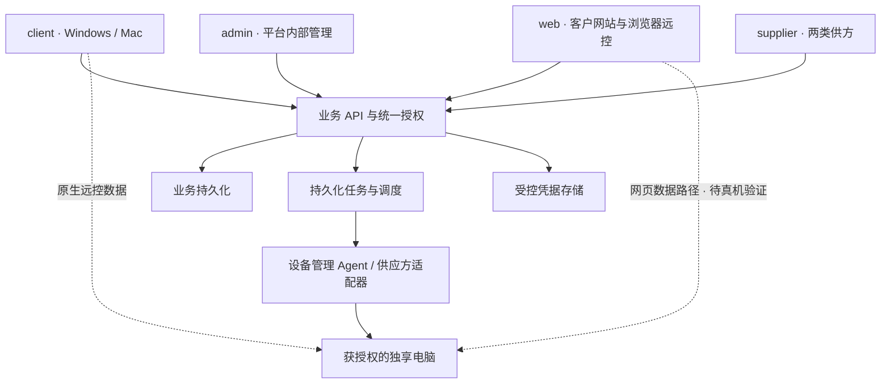
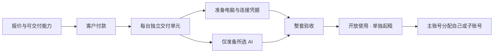

# Thinkpasser 技术架构总览

状态：技术设计基线。业务规则来自已确认需求；本文中标注“建议”的实现用于指导开发，不代表相应组件已经接通或验收。更新日期：2026-11-08。

本文集中说明五个模块怎样协作，以及订单、电脑、AI、卡资源、连接密码、会话、租期和售后的关系。业务细则见[需求文档](plans/2026-11-08-remote-computer-requirements.md)，原始回答见[确认记录](questionnaires/远程电脑平台完整需求确认表.md)。

## 1. 架构成立的业务条件

- 电脑是基础商品；平台提供的 Claude Code、Codex 必须关联电脑，支持纯电脑及三种 AI 搭配，不单独销售平台 AI。
- Claude 与 Codex 各自可选。软件预装、账号已登录、已购买权益、实际可调用是不同状态。
- 原生控制端和被控电脑支持 Windows／Mac；网页真实远控也是必需能力。普通客户不接入私人电脑。
- 供应商按电脑侧、卡／订阅侧两类组织，均可自营或合作；一家机构可承担两类。指定账号开通是卡／订阅侧任务，不另设固定第三类供应商。
- 客户先付款，再按单准备。首次整套验收并开放使用时起租，多台按交付单元分别计时，不等客户第一次连接。
- 账号、设备分配和电脑租期决定完整远控资格。AI 未购买或已到期，不锁住有效电脑。
- 正常已交付买定离手；主动换购按新单计价，故障售后按已确认的例外处理。资金规则不能从客户端界面推导。

## 2. 五个模块与代码归属

| 模块 | 产品责任 | 当前已有内容 |
| --- | --- | --- |
| [client/](../client/README.md) | Windows／Mac 客户端、被控端集成、平台登录与一键远控、接管、购买回跳 | 桌面界面网页预览；固定RustDesk裁剪与构建准备，原生包待接入 |
| [web/](../web/README.md) | 商品、购买、客户控制台、浏览器远控、导出与售后入口 | 可交互演示前端及协议／合成验证，真实远控待接入 |
| [admin/](../admin/README.md) | 平台内部机器、账号、商品、供货、工单、财务和回收运营 | 运营演示前端，真实API和资金执行待接入 |
| [supplier/](../supplier/README.md) | 自营／合作供方入驻、资源、报价、接单、结果及售后 | 供货演示前端，真实供应接口与能力待验收 |
| [backend/](../backend/README.md) | 四端共用身份、订单、租约、权益、支付、供货编排与设备控制 | 租期纯规则和设备健康参考链路 |

业务后端按 Java／Spring Boot＋MySQL 设计，使用 Maven；原生远控保留 RustDesk 的 Rust／桌面界面集成，网页采用 TypeScript，不开发手机 App。Java 适用于订单、权限、供货、售后和调度，不强制用于采集、编码或浏览器。

建议先组织为模块化后端：业务 API 和持久化任务执行器使用相同领域契约，按运行负载分别部署；不要求先拆出大量微服务。现有 Node 代码是验证基础。具体字段、事务和接口见[详细设计](design/README.md)，生产 Java 工程与数据库迁移尚未实现。

网页验证目录中的 `authority.mjs`、`gateway-session.mjs` 是进程内参考；正式共享授权应纳入后端与被控端集成，不能由四端各自维护一套租期或权限。

## 3. 业务控制与远控数据分开

业务控制面处理登录、订单、供货、租约、授权、恢复任务和清理。桌面数据面处理画面、输入、剪贴板、文件及系统声音，不让业务 API 默认中转全部桌面内容。



RustDesk Server OSS 的发现／中继服务与平台业务后端不同。使用中继不自动拥有主子账号、租期、商品或退款能力；Linux 服务端不等于增加 Linux 桌面产品范围。

## 4. 后端领域划分

| 领域 | 责任 |
| --- | --- |
| 身份与组织 | 主子账号、当前登录身份、租户与供应商角色，多个已登录账号切换 |
| 资源与供货 | 电脑库存、供方归属、能力验收、成本报价、接单与售后 |
| 商品与交易 | 电脑配置、可选 AI、价格和规则快照、订单及独立交付单元 |
| 租约与分配 | 起租、期限、续费、补时、当前使用账号、回收与换人 |
| AI 交付 | 指定账号、邮箱来源、开通任务、平台承诺期与上游真实状态 |
| 收款与结算 | 支付确认、退款、客户实付、供货成本、预付／应付和对账 |
| 远控与凭据 | 设备身份、连接凭据版本、短时会话授权、接管、撤销 |
| 设备生命周期 | 健康观测、受限恢复、导出、清理、镜像准备及重新入库 |
| 售后与审计 | 客户工单、故障核定、赔付执行、动作与结果证据 |

金额按币种最小单位保存，时间使用服务端 UTC。前端提交的角色、库存、价格、支付状态或截止时间不能直接成为可信结果。

## 5. 核心对象不能合并

| 对象 | 关键关联与含义 |
| --- | --- |
| 客户组织与账号 | 个人客户也可有一个组织；主账号直接创建子账号，切换登录不合并权限 |
| 供应商 | 两类能力及自营／合作来源；供应商归属与客户使用分配分开 |
| Computer | 稳定平台机器 ID、供方机器引用、OS／硬件、能力和库存状态 |
| Order / OrderItem | 客户成交金额、币种、所选电脑与 AI、购买时规则快照 |
| DeliveryUnit | 一台电脑及本次所购 AI 的交付单元，多台订单可各自准备交付 |
| Lease / LeaseTerm | 该交付关系的租约、购买周期及实际起止；续费和补时有独立记录 |
| Assignment | 当前使用账号、机器、租约和分配版本，不能靠设备自报归属 |
| AiEntitlement | 挂接交付单元／租约的 AI 项目、原实付与原承诺服务期 |
| AiAccount / UpstreamSubscription | 指定邮箱／账号及真实订阅、认证、失效情况，不等于平台账号 |
| CardReference / SupplierPayment | 实际需要时记录卡资源脱敏引用与供货付款，不等于 AI 已可用 |
| DeviceIdentity | 管理 Agent 与被控端可信身份，不是设备 ID 字符串本身 |
| DeviceCredential | RustDesk 设备连接凭据安全引用、当前版本和对应租约／分配 |
| RemoteSession | 使用账号、目标电脑、会话代次、期限、通道绑定和撤销状态 |
| Ticket / Compensation / Refund | 工单、核实区间、电脑补时和资金结果，各自有执行状态 |
| LifecycleOperation | 重启、凭据轮换、导出、清理等受限动作及真实回执 |

业务持久化采用 MySQL InnoDB，以事务、生成列唯一索引和版本检查保证关键关系；任务日志和资金流水持久化，缓存不能作为归属或金额的唯一依据。不能直接套用其他数据库的部分索引语法。

一单多台时，交付、补偿和退款定位到具体交付单元，不把一台的异常扩大成整单。AI 项必须挂接电脑交付单元；首单可直接购买组合，并不要求客户事先已有已交付电脑。

### 必须执行的约束

- 同一账号同时最多一个有效电脑分配，同一电脑不能被两个使用账号同时占用。
- “主账号买了多台”和“主账号自己同时使用多台”不同，待分配库存不自动授予桌面访问。
- 供应商只能处理自己获准的资源和任务；供货身份、硬件所有权不自动授予客户桌面权限。
- 同一订单支付回调、供货结果、补偿确认或任务重试不能重复发放权益、扣款或退款。
- 凭据、机器 ID、租约、平台账号和 AI 账号分别建模；密码不能充当这些对象的主键。

## 6. 四类用户凭据与设备身份

| 内容 | 用途 |
| --- | --- |
| 平台账号密码／邮箱验证码 | 确认正在使用平台的主账号或子账号 |
| RustDesk 设备连接密码 | 目标被控电脑的底层远控认证 |
| Windows／macOS 登录密码 | 进入远端 OS 会话，和 RustDesk 认证分开 |
| Claude／Codex 凭据 | AI 账号认证，不拿来登录平台或连接电脑 |
| 设备证书／密钥 | 管理通道识别已注册设备，另有轮换和吊销生命周期 |

平台准备或客户提供的邮箱仍须按真实身份和官方流程处理。把订阅关联到电脑不等于有权复制、托管第三方登录令牌。

## 7. RustDesk 密码如何对应购后电脑

用户提出：RustDesk 可以设置密码，这可以对应客户购买后的那台电脑。这里明确指设备连接密码，不是平台登录密码。这个想法可纳入原有“两层授权”设计。

建议关联：

```text
客户订单交付单元 → 租约 → 电脑稳定 ID
                         ├─ 当前使用账号 / 分配版本
                         ├─ RustDesk 设备 ID 与可信身份
                         └─ 设备连接凭据版本 / 安全引用
```

### 推荐生命周期

1. **备机**：为每机生成或受控接管独立连接凭据，不能将一个平台密码或镜像内共用密码分配给所有机器。
2. **验证**：分别取得设置回执并做受控认证验证；设置成功只是交付验收的一环，不替代 AI 可用和整套交付条件。
3. **交付与使用**：仍按实际分配决定谁能进入。建议用户在电脑列表一键连接，由受控适配层处理底层凭据。
4. **续费／补时**：保留环境，更新租约与授权；旧到期任务因版本不匹配失效，不提前锁机或清机。
5. **到期**：拒绝新会话、撤销并关闭已有会话；凭据失效／轮换单独确认，不能把改密成功当作旧会话已断。
6. **保留期**：只提供受限文件导出，不为了导出发放完整远控凭据。
7. **团队换人**：撤销原分配与会话，轮换凭据；主账号可选保留文件软件或重置，私人登录凭据独立处理。**到期回库／新租约**：清理旧客户数据和登录状态、恢复最新模板并验证，再用于后续交付。

建议普通界面不展示长期密码；密码是否向客户展示不是此次已经确认的 UI 要求。后台保存安全引用及版本，秘密材料受控保存，不放 URL、日志、公共安装包或共享初始镜像。

RustDesk 官方文档说明了永久密码、本机 `--password` 设置入口，以及 `approve-mode`、`verification-method`。它们不代表本平台已有批量远程改密 API，也不代表上游会识别我们的租约。[客户端文档](https://rustdesk.com/docs/en/client/)、[无人值守说明](https://www.rustdesk.com/blog/rustdesk-unattended-access-setup/)、[认证设置](https://rustdesk.com/docs/en/self-host/client-configuration/advanced-settings/)

平台账号／租约授权与 RustDesk 密码认证必须同时成立；不允许仅凭设备 ID 和长期密码绕过平台。短时授权不能原样塞进上游 password 字段。具体设置、轮换、受保护本机接口及原生强制检查仍待实现。

## 8. 会话建立、接管与撤销

建议流程：

1. 客户端以当前平台登录身份请求连接，只选择已分配电脑，不提交任意设备 ID、密码或中继地址来决定身份。
2. 后端核对账号、租户、机器归属、分配、租约、服务端当前时间和可连接状态；不把是否买 AI 当作整机资格。
3. 没有有效控制会话时准备新会话；已有会话时返回当前会话标识，客户确认接管后再继续。
4. 在事务内更新会话代次，通知旧通道释放键鼠并关闭画面／输入／文件等通道；设备确认后才启用新会话。
5. 签发短时、目标绑定的授权，原生适配层验证平台签名、设备身份、通道与密钥持有，并完成 RustDesk 底层认证。
6. 会话定期续租；每次续租重新核对分配和期限。到期、停用、回收或接管均可撤销。
7. 正常退出浏览器或客户端只结束控制连接，不关闭远端电脑和开发任务。

生产授权建议绑定账号、租户、设备、租约、分配版本、凭据版本、会话 ID／epoch、签名密钥版本及到期时间。现有参考授权字段并不覆盖全部内容，不能描述为生产验证器。

短会话期限不能超过电脑截止时间。设备本地设置有上限的授权期限与可信时间基准；控制面断联时不能因本机时钟回拨或缓存永久密码而无限续命。

详细握手与通道契约见 [gateway-contract.md](../web/remote-desktop/gateway-contract.md)。现有字符串指纹比较没有完成密钥持有证明，真实原生路径还需补齐。

## 9. 原生与网页的数据路径

### 原生 Windows／Mac

复用固定 RustDesk 源码的采集、编码、传输、输入、文件、剪贴板和系统声音。控制端及被控端都需要平台授权钩子；任意 ID 输入框被隐藏，不能代替底层校验。

### 浏览器

建议先验证“被控侧适配器复用已编码画面＋授权信令＋浏览器可解码数据路径”。原型采用 WebRTC DataChannel 和 WebCodecs VP8，但当前只是同页两个 PeerConnection 的合成回环。

| 路线 | 信任与资源影响 | 当前定位 |
| --- | --- | --- |
| 被控侧适配器 | 业务 API 不默认解密桌面；需设备身份、信令与通道绑定 | 优先做 Windows／Mac 真机可行性验证 |
| 云端原生网关 | 网关作为控制端可以接触桌面内容，存在额外流量／转码与隔离成本 | 保留候选，不默认为客户已接受的信任模型 |
| 浏览器完整实现原生协议 | 自行补齐认证、加密、输入、编解码、文件等 | 工作量较大，不能把公开 Dart bridge 当现成内核 |

不能仅凭 WebRTC、TLS 或加密字段就宣称端到端加密。也不能直接复用未取得源码／授权的官方 Pro 后台或付费 Web V2。

中文组合输入、Windows／Mac 快捷键、跨浏览器编解码、系统声音、文件、重连、接管和跨网中继均需真机验证；已有 VP8 合成测试不代表全部功能完成。

## 10. 供应商、账号与 AI 开通

电脑侧和卡／订阅侧可以独立供货，平台自营同样作为供货身份入驻。供应商可以由平台创建或自主申请，通过审核后才供货；实际资源还须单独验收。

客户付款后，一台电脑的交付单元拆成供机与所购 AI 的指定账号开通任务。AI 的目标邮箱可由平台准备或客户提供，任务不能悄悄换成另一个现成账号。

卡／订阅供方的类型不等于它实际具备全部能力：纯付款卡、付款成功、账号可登录和订阅可用分别验证。真正具备开通能力的合作方或自营供货身份接任务，正式 API 或人工回报按真实能力适配。

卡自身的开卡、充值、冻结和销卡由供方管理；平台直接进行这些资金操作未被要求为必需功能。平台跟踪资源引用、采购、任务、结果、期限和成本，不增加固定第三类“AI 开通供应商”。

同一张付款卡能付几个账号不能从模型推断。只记录真实付款和权益关联，不假设“一邮箱一卡”、无限复用或卡状态等于 AI 状态。

上游允许的交付范围、真实认证主体和实际开通流程需核实。产品需求确认不等于已获得供应或商业交付权限；AI 未完成所需步骤时不能标记可用。

## 11. 下单到交付



- 缺少正常交付能力的商品不收预约款；“付款后准备”不要求 AI 账号在付款前已经开好。
- 报价、库存占用、实际收款、准备完成、交付、账号分配分成独立状态。
- 初次所购电脑和 AI 全部满足承诺后交付；纯电脑不等待未购买的 AI。
- 多台订单可部分交付，各套独立起租；一个单元失败不停止其他有效电脑。
- 库存锁过期后的迟到付款不能抢走已分配他人的机器，必须重新核对或进入交付异常处理。
- 未交付异常保留等待、该套整退、退 AI 改纯电脑的既定选择；取消后拦截迟到的开通结果。

## 12. 租约、AI 与资源状态

建议分别记录机器库存、交付、租约、AI 和资金状态，不塞成一个“订单正常／异常”。

| 状态轴 | 示例 |
| --- | --- |
| 机器库存 | 待验收、可用、锁定、准备中、在租、保留、清理中、隔离 |
| 交付单元 | 待支付、准备中、可交付、已交付、取消、交付异常 |
| 租约 | 未交付、有效、仅导出、终止；续费／补时另有事件 |
| AI 项 | 未购买是无对应权益项；已购可处准备、可用、中断、到期、终止 |
| 资金 | 待支付、已确认、退款申请、处理中、已退、失败／结果不明 |
| 设备操作 | 排队、送达、接单、效果待验证、失败、未配置、结果不明 |

上游 AI 真实截止、平台原始承诺截止、电脑截止及会话截止分别保存。电脑截止是平台完整远控上限，不能反向改写上游日期。

```text
完整桌面资格 = 当前账号有效 ∧ 当前机器分配匹配
             ∧ 电脑已交付且租约有效 ∧ 服务端当前时间 < 电脑截止
```

平台 AI 交付还需有该电脑对应的已购、已完成、未终止且处承诺期内的 AI 项；实际可调用还取决于真实上游状态。AI 不成立不反向锁整台电脑。

## 13. 续费、加购、补时与换购

- **续费**：默认手动，主账号可开启自动续当前组合；手动可只续电脑或重新选 AI。纯电脑不自动加 AI。
- **保留期续费**：从原电脑截止顺延，仍需检查新截止和重置状态，不能承诺已清理环境恢复。
- **AI 加购**：按三十天标准价全额收，实际截止对齐购买时电脑截止；即使剩一天也可买，付款前说明费用和实际期限。
- **正常准备等待**：已确认补电脑时间，AI 原截止不延。按实际等待等量换算是当前实施建议，不能冒充已接入执行。
- **故障补电脑时间**：按已确认资格和核实区间执行；不自动延 AI，不改变原 AI 退款分母。
- **主动换购**：新电脑按全价新单，所选 AI 才重新购买；旧电脑和旧 AI 余额不退不抵。客户先自行导出并确认，新机初始环境。
- **故障替代机**：继续售后履约及原租约／已购权益，不套用主动换购再收全价。

提前只续电脑不提前剥夺原周期仍有效 AI；下一电脑续费段不凭空赠送 AI。退剩余服务费并终止的 AI 项与局部故障赔付分别处理，后者不自动取消服务。

## 14. 收款、退款与供货成本

目标收款渠道为支付宝、微信、国际银行卡及 PayPal，网页与客户端共用收款服务。客户向平台付款，供方成本、预付／应付及结算另记。

建议流程：服务端报价和订单快照 → 支付渠道 → 验签／查询真实结果 → 核对金额币种 → 事务记录收款和后续任务。前端显示成功、客户端回跳或供应商口头反馈不能确认到账。

原生登录和收银回跳使用一次性 code／state 交换，不将密码、价格、权益或已支付标识直接放进 URI。交换绑定发起账号，避免切换登录后误用前一账号结果。

退款关联原收款订单和原付款人；子账号提工单不改变收款与退款归属。客户已付款价格不随供方成本上涨自动补差，主动新增／换购需确认新金额。

AI 故障退费是平台给客户的售后支出，不假设官方能按天退钱，也不自动减少长期供货成本。供方追偿按真实约定另行核算，不预设可以单方扣结算款。

支付、退款、供应商开通结果不明时先查询和对账，不盲目重复扣款或开通。没有上游幂等支持时，不能宣称本地 job ID 就保证外部只执行一次。

## 15. 售后规则怎样落到系统

| 情况 | 执行范围 |
| --- | --- |
| 没有客户工单 | 继续监控维修，不主动发故障补偿 |
| 电脑责任故障 | 满足申报资格后补电脑时间；仅对确已购买且承诺期内 AI 按实际受影响区间退费 |
| 纯电脑故障 | 不计算不存在的 AI 金额 |
| AI 单独失效 | 先给修复窗口；窗口内修好不退，超窗仍未恢复退未提供部分并终止该 AI 的本次平台交付 |
| 终止整套故障服务 | 同步结束电脑与其 AI 平台交付，结清未提供部分，不留无电脑 AI |
| 正常主动闲置／退租 | 已交付正常服务不退，原服务保留到已购截止 |

已确认：系统记录计算、管理端核定、系统执行。按核实实际故障区间计算，不以提单时间截断此前故障。AI 金额按原实付与原承诺服务时长分摊；例：300元／20天 × 1天 = 15元。

累计故障区间去重、扣除已退金额，总退款不超对应项目原实付。补时记录、付款退款和供应方责任不能压成一个“处理完成”。

电脑补时申报最晚在电脑到期前至少三天提交，这是按原答卷与聊天补充记录的现行规则。普通规则下最后三天新发生故障无法提前三天申请，不暗加例外；维修及既定 AI 故障退费分别处理。具体处理时限为后台参数。

## 16. 到期、导出与清理

1. 服务端期限触发撤权；已有连接也须关闭，不允许一直保持会话越期使用。
2. 原环境保留三天，不分配给其他使用者。
3. 导出由独立文件接口授权，限制当前身份、目标租约、路径、时限及读权限；不开放桌面或命令执行来代替导出。
4. 期满清理前再次检查租约版本、续费／补时和实际重置状态，旧调度任务不得擦除已续费环境。
5. 清理客户文件、OS／第三方登录状态和旧远控凭据，恢复最新基础模板。
6. 核实实际结果后回库；API 接单或进程退出不能当作已抹除证据。

正常到期不视为故障。平台默认不提供客户数据备份，原机保留三天不等于另有备份。导出、清理和重分配的互斥及异常处理必须留有状态和证据。

## 17. 设备管理 Agent 与恢复

管理 Agent 与 RustDesk 服务分别运行，通过平台管理通道报告身份、启动代次、序列和健康采样。它可以辅助采集和恢复，但同机同网不等于独立带外控制。

- 心跳新鲜、进程存在、注册成功、桌面真实可达分别观测，不能只看端口或 PID 就报正常。
- Mac 长期运行失联、重启后恢复是已报告现象；没有证据把原因定成端口占用。
- 恢复区分重启远控服务、重启 OS、提供商带外恢复；当前参考方案人工发起，不自动逐层升级到整机重启。
- 主账号可重启旗下机器、子账号仅自己的；平台内部恢复与客户入口分权。客户重装仅主账号发起。
- 管理命令只允许窄动作、目标设备、有效期、当前分配与启动身份，不提供任意 shell 执行接口。
- 接单、操作效果、桌面恢复分别验证；超时或应答丢失标记结果不明，不用重复重启掩盖未知。

客户拥有 OS 管理员权限时，可停用或修改机内程序。机器凭据、Agent 和本机时钟不能单独保证租期、隔离与完整擦盘；供机验收还需供应方独立控制、网络／电源／镜像恢复和状态查询能力。详见[可靠性研究](plans/2026-11-08-mac-connection-reliability.md)及[设备管理协议](../backend/device-health/protocol-v1.md)。

## 18. 一致性、任务与审计

建议业务事实、资金结果和待执行任务使用事务提交及 outbox／持久化任务机制，接受任务可能重复投递，靠幂等及真实结果查询控制副作用。

| 约束 | 机制 |
| --- | --- |
| 单账号／单机唯一分配 | 数据库唯一约束、事务及当前分配版本 |
| 接管竞争 | 比较当前 session／epoch，设备确认旧通道已关 |
| 回收与旧任务竞争 | 租约／分配／凭据版本作为执行前条件 |
| 重复支付／退款 | 渠道交易号与业务幂等键唯一，真实回执和累计金额校验 |
| 清理误执行 | 每次执行重新读租约、保留期和重置状态 |
| 外部操作结果不明 | 保持 unknown，查询／人工核对，不伪造成功 |
| 凭据泄漏 | 安全引用、最小读取范围、脱敏日志和密钥轮换 |

应保留订单、交付、租约变更、分配、凭据版本、会话、机器操作、工单和资金链路的关联审计。日志不记录客户代码、桌面内容或明文凭据来充当普通诊断。

## 19. 接口边界草案

以下是设计契约示意，不是已经存在的生产 API：

| 边界 | 典型请求 |
| --- | --- |
| 客户业务 | 报价／订单、电脑列表、续费、AI 加购、分配、导出、工单 |
| 会话授权 | `POST /devices/{id}/sessions`、续租、接管确认、撤销 |
| 平台内部 | 供方审核、资源验收、商品、派单、补偿核定、回收 |
| 供应商 | 自身资源、报价、接单、任务结果、供货售后及结算查询 |
| 设备管理 | 已注册设备握手、心跳、受限命令、接单与结果回报 |
| 支付回调 | 分渠道验签、订单金额币种核对、对账及退款结果 |

用户、供应商和设备身份分别认证。HTTP 请求体里自报 tenant、supplier、actor 或设备归属不能覆盖可信记录。内部接口不能直接暴露给客户或供方使用。

## 20. 能力裁剪与发布

保留桌面、输入、中文、显示调整、文本／图片剪贴板、文件、系统声音、重连、接管及必要诊断。

排除摄像头、麦克风转发／语音、打印、通用隧道、录像、内置聊天、任意设备 ID 入口和独立远程终端。用户仍可在完整远程桌面内运行 OS 终端、Claude Code 与 Codex。

裁剪覆盖 UI、CLI／深链接、协议入口、被控权限、配置恢复、安装器和包内权限；不能只删按钮或误删远控必要的 TCP／UDP／WebRTC 依赖。

原生包需要固定源码、Rust／Flutter 工具链、真实 Windows／Mac 构建、签名／Mac 公证、升级与卸载验证。当前产品更新源、最终证书与包标识尚未配置，不使用原厂更新绕回未裁剪能力。

上游固定提交、许可和源文件校验随 [client/rustdesk/](../client/rustdesk/README.md) 及 [web/remote-desktop/upstream/](../web/remote-desktop/upstream/manifest.json) 保留。复用按随附许可处理，不把 Pro 或 Web V2 视为已取得的开源组件。

## 21. 现有证据与实际缺口

| 现有内容 | 已验证范围 | 还没有证明 |
| --- | --- | --- |
| [租期规则](../backend/domain/README.md) | 期限边界、加购价格与续费锚点的纯计算 | 生产身份、库存、到账、实际撤权或擦盘 |
| [网页验证工程](../web/remote-desktop/README.md) | 协议、签名会话参考、合成 VP8 与本地回环 | 真机采集／输入、完整加密身份、跨网、文件与音频 |
| [设备健康](../backend/device-health/README.md) | 本地签名消息、持久化、防重放、命令去重和 unknown 处理 | 真机采集、重启、带外恢复、独立可达验证 |
| [原生裁剪](../client/rustdesk/README.md) | 补丁、静态边界、Python 构建变换及权限输入 | 原生编译、签名、真实远控与租期／密码强制 |
| 商业对接 | 已确认商品、供货、收退款和售后规则 | 真实供应能力、认证、开通、收退款接口及结算验收 |

根目录 `npm test` 当前有44项参考测试；数字代表这些代码的验证范围，不代表五个产品模块已经完成。详细范围见各目录 README 与 verification 记录。

四端交互界面另以`npm run test:ui`验证本地规则和DOM组件，以`npm run build`验证类型及打包；不替代浏览器画面、原生包或真实服务端验收。详见[前端交接](design/07-frontend-handoff.md)。

## 22. 实施顺序与验收闭环

| 步骤 | 交付重点 | 通过条件 |
| --- | --- | --- |
| 领域与契约 | 对象、权限、价格及状态快照，API 与任务契约 | 四端引用同一业务规则，关键并发和金额约束有验证 |
| 真机远控基础 | Windows／Mac 被控与原生、设备凭据和平台授权；网页路径可行性 | 实际连接、到期断开、改密／换人、接管与真实输入可验证 |
| 供应与支付 | 两类供方、自营任务、指定账号及支付／退款适配 | 真实结果核对，不把模拟成功当交付 |
| 五模块联调 | 下单、准备、分批交付、分配、加购、续费、工单和回收 | 一条真实订单完整跑通，失败与补偿分支可对账 |
| 持续运行与发布 | 重连、Mac 长期运行、恢复、保留导出、清理和签名包 | 无越期入口、无串租户数据、无假恢复／假清理证据 |

这些步骤是工程实施顺序，不取消网页或任一端的既定范围，也不要求先填首批地区、台数或采购预算才能设计。

## 23. 必须覆盖的验收场景

- 纯电脑、电脑＋Claude、电脑＋Codex、电脑＋两者；不存在无电脑的 AI 单。
- 主子账号分配、账号切换、重复分配、跨租户访问和主账号管理／桌面权限分离。
- 首次整套与多台部分交付，付款后准备，未交付异常及取消后的迟到结果。
- 不复用平台密码、每机独立凭据、凭据写入失败／未知、旧使用者凭据失效。
- 原生与网页直连／中继／重连／文件入口一致授权，接管及电脑到期关闭已有通道。
- AI 到期不锁有效电脑，电脑补时不延 AI，AI 加购及续费显示实际期限。
- 支付／开通／退款回调重复、超时、状态不明和跨系统结果查询。
- 故障区间去重、原金额／原承诺期分摊、纯电脑无 AI 退款、终止整套无独立 AI 交付。
- 三天仅导出、保留期续费、过期清理任务取消、重置后验证和不同客户之间凭据清理。
- 管理 Agent 断联、OS／远控进程重启、供应方能力未配置、命令结果不明及禁止盲目重试。
- Windows 权限／UAC、Mac 采集与辅助功能、中文与快捷键、剪贴板、文件、系统声音及长期运行。

## 24. 文档职责与后续更新

- 本文：技术结构、对象关系、边界、接口和验收思路。
- [详细设计与开发交接](design/README.md)：MySQL数据关系、Java职责、接口字段、难点方案、四端页面和验证条件。
- [需求文档](plans/2026-11-08-remote-computer-requirements.md)：已确认业务和实现范围。
- [确认记录](questionnaires/远程电脑平台完整需求确认表.md)及其 [JSON](questionnaires/remote-platform-questionnaire-data.json)：原始答案、后续补充和建议状态。
- [RustDesk 构建](../client/rustdesk/BUILD_INTEGRATION.md)、[会话契约](../web/remote-desktop/gateway-contract.md)、[设备协议](../backend/device-health/protocol-v1.md)：专项工程约定。

实施中新增证据应更新对应状态，不以“有代码／有设置／有回执”代替真实能力验收，也不把已经确认的业务重新变成重复问卷。
