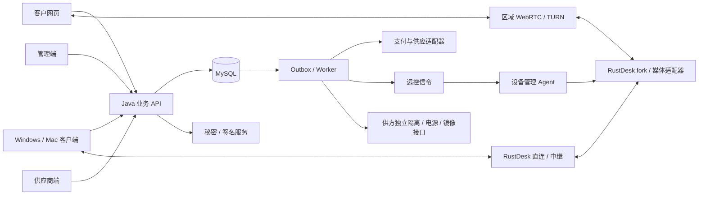

# 生产实现蓝图

这是实现规范，不是已上线能力说明。后端本轮只设计；现有页面使用本地演示数据。已确认商业规则见[需求记录](../plans/2026-11-08-remote-computer-requirements.md)，字段以 [OpenAPI](../../backend/contracts/openapi.json)、[状态模型](../../backend/contracts/state-machines.json)和[远控消息](../../backend/contracts/remote-signaling.schema.json)为准。下文的时限、容量和运维目标为工程初值，不是新添加的客户承诺。

个人是默认客户路径，团队在需要多人管理时开通；不是所有客户都先走企业主子账号。个人购买、交付自动使用、换机和升级，以及本轮发现的明确问题见[个人路径与全面复核](11-review-and-personal-workspace.md)。

## 1. 技术决定

| 层 | 采用方案 | 实现边界 |
| --- | --- | --- |
| 网页、运营、供方 | Vue 3、TypeScript、Vite，多入口工程；按角色生成路由与 API 客户端 | 共用组件和类型；真实权限始终由服务端判断 |
| Windows／Mac 客户端 | 固定版本 RustDesk 开源核心、Rust；保留其现有桌面 UI 集成，按裁剪方案改界面 | 只做桌面客户端；Flutter 在此仅可能是既有桌面壳的实现依赖，不代表做手机 App，也不重写网页为 Flutter |
| 被控服务 | RustDesk fork＋独立 Rust 管理 Agent／受限特权 helper | 采集、编码、输入、服务恢复、凭据与只读导出；不向业务后台开放任意 shell |
| 业务后端 | Java 21 LTS、Spring Boot 4.1.x、Spring Security、Spring JDBC、Flyway、Maven Wrapper 3.9.14 | 模块化单体；显式 SQL 和事务，API／worker／信令可用同一工程不同进程角色部署 |
| 业务数据库 | MySQL 8.4 LTS、InnoDB、READ COMMITTED | 金额、库存、归属、唯一会话和幂等的唯一事实源；不以缓存锁代替数据库约束 |
| 任务与通知 | MySQL outbox＋持久 job；Redis 可作缓存、限流及跨实例通知 | 至少一次执行、按操作 ID 去重；丢通知由数据库恢复 |
| 浏览器远控 | WebRTC＋区域 coturn，设备侧原生媒体适配器；能力协商后选择支持的编码／传输 | Java 不转码桌面；先做真机证明，不能将 RustDesk 原协议直接当浏览器协议 |
| 秘密与签名 | Vault KV v2／Transit，独立签名身份，信封加密、审计；Ed25519 标准 JWS | 数据库只留 secretRef；Vault Transit 提供 Ed25519 签名原语，Java 签名服务组装标准 JWS。[Transit 文档](https://docs.hashicorp.com/vault/docs/secrets/transit)。验证库、签名服务、Rust 与浏览器必须通过同一测试向量 |
| 部署与观察 | Linux 容器运行 Java／信令／中继；OpenTelemetry、Prometheus、结构化日志 | Windows／Mac 服务和安装包另行签名发布；控制面、媒体面、设备管理面分开 |

这是选定的实施基线，不是让开发者再任选框架。本地已发现 JDK 17、Maven 3.9.14、MySQL 8.0.44；它们不等于上述生产环境已经安装或通过构建。不要改动本机已有数据库。建立 Java 工程时用隔离的 Java 21 工具链及 MySQL 8.4 测试实例，锁定正式补丁版本和依赖清单。Spring Boot 当前官方文档给出的 Java／Maven 要求覆盖这一组合；MySQL 将 8.4 列入 LTS 路线。[Spring 系统要求](https://docs.spring.io/spring-boot/system-requirements.html)、[MySQL 发布模型](https://dev.mysql.com/doc/refman/8.4/en/mysql-releases.html)

## 2. 组件和信任边界

客户连接任意国家的可售电脑，业务授权流程相同；区域只影响供货属性、媒体路由和实际延迟。不得以浏览器 IP、支付卡国家或代理配置推断第三方账号具备使用资格。

公网业务入口只接受客户／管理身份；设备入口使用独立 mTLS，证书映射电脑身份；中继不授予业务权限。供应商不能通过资源所有权进入客户桌面。维护确需访问时必须有限定动作、审批和审计，不能复用客户凭据。

Java 包按 `identity / catalog / commerce / payments / lease / supply / delivery / remote / device / exports / aftersale / audit` 划分。各模块暴露应用服务，领域模块不直接调用支付 SDK 或设备网络；适配器实现端口。禁止四端各自计算价格、退款或租期。

## 3. 身份、账号切换和子账号

浏览器同源会话用 HttpOnly、Secure、SameSite Cookie；写请求校验 CSRF、Origin，跨域明确白名单。访问令牌短时；刷新令牌只存哈希，轮换并检测 family 重放。桌面端经系统浏览器登录，使用单次短时授权码＋PKCE、随机 state；回跳码绑定客户端和 redirectUri，交换成功后失效。系统钥匙串／凭据管理器保存各已登录账号的刷新凭据，网页不把长期令牌放 localStorage。

主账号直接创建同租户子账号并设临时密码；第一次登录强制改密。主账号重置密码会使旧刷新会话和远控授权失效。禁用、登出和换人递增认证／分配撤权版本；只影响相应主体。管理账号强制 MFA，supplier 身份只读写本供方资源。

“保存多个登录账号”是多个独立会话的安全引用；切换先停止本地输入和旧连接续租，再切换 activeAccount。旧账号不能继续后台发送键鼠。主账号可以管理多台，只有实际分配给自身的一台可连接；子账号不取得购买、续费、查看其他成员文件或修改供方信息的权限。

## 4. 商品、报价、付款与库存

商品仅为电脑及其可选 Claude／Codex。Quote 返回价格、币种、配置、AI 实际期限、供货承诺、条款版本和 `disclosureHash`；客户确认的哈希必须与服务端快照相同。商品修改只影响以后报价。首单可多台；每台是独立 unit，其目标账号和验收集合分别记录。

创建订单时消费一次 Quote，锁库存或经审核的供应容量，生成占用截止、订单项和 outbox。单纯浏览报价不永久占机器。占用到期先查询支付；不能因回调慢就把已支付电脑卖给另一人。超期付款不抢已出租资源，进入异常处理并原路退款或取得新确认。

每一次支付请求是 `payment_attempt`，每一笔实际成功款是不可变的 `payment_receipt`。渠道回跳不确认到账；后端验签并必要时主动查询。按渠道＋商户＋交易号去重真实收款，按 eventId 去重通知。订单只接受一笔符合条件的 receipt 用来履约；另一笔真实成功款进入多收处理，不能再次备机。已取消订单的迟到成功也保留事实并退款。

资金事实接收事务只追加事件与 receipt，不反向锁订单。应用 worker 按全局锁序将 receipt 应用到订单、续费和库存；中途崩溃重放不重复交付。外部成功不能被本地业务失败抹成未收款。付款方式的正式商户接入、支付协议和自动扣款能力独立验证；未配置的真实渠道不展示为可支付。

## 5. 卡供应、AI 开通、采购和结算

只有两类供应商：电脑，卡／订阅侧。后一类按能力区分 `card_supply / ai_activate / ai_renew / ai_repair`，不是增加第三类供方。审核供方账号、审核具体能力、验收具体资源是三个步骤。我们自营也用相同流程。

**纯卡商路径**：登记脱敏卡引用和报价 → 平台采购／验收卡资源 → 记录持有人、出资方、保管方及获授权操作方 → 分配给有开通能力的执行方 → 对指定 AI 账号操作 → 回报上游事实 → 平台验证 → 交付。纯卡商不因供卡而获得客户邮箱、登录秘密或 AI 账号操作权。

**一体供方路径**：该供方同时通过供卡和开通能力审核，可承接两段任务；采购、付款、开通和验收仍分别记录。**自营路径**：平台作为执行方使用获授权的资源操作；只记真实成本，不虚构向自己的应付账款。

卡和机器不是以“卡号写进机器”来绑定。关联链为：`采购项 → 脱敏支付工具引用 → 上游操作 → AI账号 → entitlement → orderItem/unit/lease → 当前allocation/电脑`。登录后的令牌只通过受控执行通道进入对应电脑／OS 身份，不写入商品、日志或公共镜像。

| 实体 | 关键字段与必须保持的约束 |
| --- | --- |
| supply_purchase / items | supplier、resource、qty、成本币种、报价／合同快照、采购状态、付款状态；允许提前采购而没有客户订单 |
| payment_instrument_reference | safeRef、owner、holder、funder、custodian、authorizedOperator、授权证据；不保存网页可见 PAN／CVV |
| fund_reservation | purchase／task、币种、预留金额、剩余金额、状态；只表示内部资金占用，不冒充卡余额或上游扣款 |
| upstream_operation / result | attemptId、精确账号／资源、幂等外部号、金额、confirmed/failed/unknown、凭证；结果追加保存 |
| supplier_task / attempt | supplierResourceId、aiEntitlementId、targetAccountId、provider、fulfillmentVersion、attemptId、截止及证据；AI 任务必须精确匹配同一权益 |
| supplier_obligation / settlement | 核定成本、预付抵扣、应付、实付、贷项、上游退款、争议；关联采购或任务，不强制每笔只有 taskId |

“发起开通”可自动派单；是否自动操作取决于已验证的供方 API。无 API 时使用受控人工任务、截止提醒和证据回报，状态仍是 preparing；不能用脚本模拟官方成功。需要 KYC／本人验证时由有资格主体通过官方路径完成，不能承诺有卡即自动过验证，也不能将不被允许的订阅转售模式列为已验证供货能力。[既有身份核验研究](../plans/2026-11-08-claude-delivery-and-verification.md)

资源容量、成本和承诺时间用于后台匹配。匹配器先按审核能力、账号模式、地区、覆盖期、库存和授权过滤，再按成本／截止排序，锁定资源预留；不是单纯选最便宜。接单失败释放容量并新建 attempt；结果未知先对账，不盲目新开账号或重复付款。

取消后迟到扣款或开通结果照样写 `upstream_result`，标记 `late_result`。旧任务终态不重开；旧履约代际不能交付。已发生成本与客户应退款分开；平台供货失败不能因为上游不退款而扣客户退款。对供方扣款或追偿须有真实合同依据。

## 6. 精确交付、续费和服务段

交付资格从订单项推导，不对“现存所有任务”做 `every(verified)`：缺少任务也不能通过。新 unit 必须有电脑证据及本单所有 `entitlementId` 的验证证据。两笔同 provider 未来续费必须是不同权益，验收前一笔不得激活后一笔。

首次开放前重新验证真实连接、当前镜像、账号目标、实际 AI 调用及上游覆盖 `upstreamUntil >= deliveredAt + purchasedPeriod`。较早的验收不能保证稍后起租仍有完整覆盖。全套通过后同一事务记录 unit.deliveredAt、首次电脑服务段、租约和所购 AI 承诺段，写一次通知。纯电脑不等待未购买 AI。交付即计时，不等首次连接；多台分别计时。

每个 `order_item` 都对应不可变 `service_segment`：`kind / originalPaidMinor / receiptId / promisedFrom / promisedUntil / refundReserved / refunded`。续费增加段，不能只覆盖 lease.expiresAt 丢失旧售价；提前结束时逐段裁剪并退回各原支付。

续费从原电脑截止续接。电脑续费段到账可成立，AI 续订段另行准备；旧有效 AI 保持原期限。新 AI 段失败只处理该次项目，不反向锁住已生效电脑，也不把已交付历史变成未交付整套。未选 AI 的电脑续费不会免费延长旧 AI，也不会提前删除旧有效 AI。连续段可相邻，禁止同 provider 重叠销售同一平台使用权。

加购按已确认三十天标准价收全价；付款时冻结本次 `promisedFrom=paidAt` 和当时电脑 `promisedUntil`，同时记录 `requestedAt / verifiedAt / actualAvailableAt`。界面明确实际可用从验收开始，承诺截止不会随电脑等待补时自动延长。等待期按规则补电脑，写幂等区间事件；不改原 AI 金额、承诺区间和退款分母。若验收时原截止已过，进入交付异常，不先激活一个过期权益。

首单等待不扣租期；加购等待与故障补时使用同一租约区间并集去重。续费 AI 尚未到其新段开始时只是提前准备，不因为提前下单就自动给整段等待补电脑；需要补偿的故障走工单规则，不能由通用“任务等待时长”自动发放。

## 7. 机器分配、密码和连接

平台密码、RustDesk 每机密码、OS 登录和 AI 登录分别管理。RustDesk 密码作为设备底层认证，服务端平台 grant 决定当前谁能在什么时候连接；知道 ID／旧密码不能绕过平台资格。普通流程一键连接，不向 URL、CLI 参数或日志写长期密码。改密先 pending，真实认证探针通过才 active；未知结果阻止交接。

一次连接返回 `ConnectionAttempt`。无冲突时创建 pending session；有旧连接时客户确认接管，旧 session 撤权并 closing，仍占唯一控制位。设备确认输入释放、画面／声音／剪贴板／文件通道全部关闭后，新 session 才能建立。`revokedAt` 是授权撤销事实，不能当作物理关闭证明。

新 session 的 grant 绑定机器、租约、allocation、assignment、凭据版本、账号撤权版本、epoch、sid、临时客户端公钥和能力。设备 challenge、客户端持有证明、底层 RustDesk 认证及通道绑定完成，设备签名 `SessionReady`，后端重核并提交授权状态后签发 `SessionActivated`；设备验证并开放通道、回报 `SessionActivationAck`，UI收到就绪及首帧才显示“已连接”。连接建立失败要归因到授权／信令／ICE／中继／设备认证／首帧，不能统一提示重启。

被控 fork 在首次认证、直连、中继、重连、文件专用连接和每个通道入口都强制检查平台资格；旧官方客户端、CLI、深链接不得旁路。实现位置、补丁和真机旁路拒绝证据是发布门槛；目前裁剪准备不等于已经完成此守卫。

短 grant 工程初值 30 秒，每 10 秒续租，严格取电脑截止与授权截止较小值。正常续费／补时只增加 leaseVersion，不递增撤权 epoch；旧 grant 在原有效期内完成到新版本的签名过渡，避免刚续费就掉线。到期、解绑、禁用和接管递增 epoch，并关闭全部通道。AI 到期不参与电脑授权。

新协议采用 RFC 9864 的明确 `Ed25519` JOSE 算法标识，固定算法／曲线／密钥类型白名单、`kid` 和发布版本，不接受客户端自选算法；参考代码中的旧 `EdDSA`／自定义编码不冒充新协议。JWT NumericDate 使用秒，业务时间为毫秒，明确向下取整；设备还校验毫秒租约上限并用单调时钟倒计时。可信时钟偏差超过预算即停止授权，不因离线延长租期。[RFC 9864](https://www.rfc-editor.org/rfc/rfc9864.html)、[JWT](https://www.rfc-editor.org/rfc/rfc7519.html)

WebRTC 将双方 DTLS 指纹、SDP 会话、设备身份和 grant 持有证明绑定；仅比较 body 中一个公钥字符串不构成验证。编码帧走 DataChannel 时显式规定分片、序号、时间戳、关键帧、重组上限、背压和丢弃策略；不得无限缓冲。浏览器能力不足返回明确错误。摄像头、麦克风、聊天、打印、隧道、录屏和独立远控终端按裁剪文档关闭，保留桌面内正常 OS 终端及系统声音。[WebRTC](https://www.w3.org/TR/webrtc/)、[既有帧协议](../../web/remote-desktop/gateway-contract.md)

客户端断开不退出远端开发进程。断线恢复保有临时密钥时可沿用 sid，但增加 connectionGeneration 并关闭旧传输；刷新丢密钥走新 attempt／接管。设备重启和恢复联网后先同步可信策略快照，旧 boot 的心跳不能维持在线或恢复旧授权。

## 8. 到期、导出、换人与清理

客户有 OS 管理员权限，能停 Agent、改本机环境甚至装其他远控。仅靠机内密码不能保证租期强制执行。可售验收必须验证供应方独立的网络隔离、电源或虚拟化控制、状态查询及镜像恢复路径；缺少所需能力的资源不能承诺完整套餐。外部动作失败进入隔离／人工处理，不显示已回库。

到期拒绝新会话、停止已有会话全部通道；电脑到期不登出平台账号。原环境保留三天，其间仅独立只读导出面和续费可用；不能给完整桌面后靠按钮隐藏输入来伪装仅导出。导出按原实际使用者授权，历史 exportOwner 与当前 assignment 分开保存。

导出清单包含 fileId、相对路径、大小、分块大小和哈希。按受限根目录的文件句柄读取，检查符号链接／Windows reparse point，防止路径校验和读取之间被替换。每块检查 job、actor、租约与保留截止；流服务到时中断正在进行的读取。对象 URL 过期不保证已开始的下载停止，不以无限期预签名链接交付。

保留期内续费从旧截止续接，锁同一 lease；需处理旧账号已获另一台电脑的分配冲突，不能恢复双分配。满三天先关闭所有导出并确认，再凭当前 leaseVersion／allocation 进入 resetting。执行恢复最新受批准镜像、旧用户卷／凭据清理、身份重建、远控与镜像探针；独立验收 verified 才 available。失败或 unknown 为 quarantined，禁止下一客户使用。

团队换人先释放旧连接和授权，再选择保留文件软件或清空。新使用者进入 pendingAssignment，验收完成才 active；预留账号占用也参与唯一约束。保留环境时使用新 OS 身份及分离凭据库交接工作文件；旧私人 AI／浏览器登录必须撤销或经授权迁移，不能保留整个配置目录就声称已退出登录。

主动换购：客户先导出确认，旧订单不退不抵，新电脑和可选 AI 全价重买。故障换机：保留 lease／服务段，切换 allocation，重建指定 AI 登录，按已有售后规则处理，不收主动换购全价。

## 9. 故障、退款与经营资金

管理端监控可主动发现和修复故障，但未提工单不自动补偿。客户提工单后，平台核实故障区间、责任及修复窗口；系统依已批准事实计算和执行。电脑普通补时申请仍保留原确认的“到期前至少三天”条件，不能悄悄改成任意到期前。

AI 单项故障先给修复窗口，窗内修好不退；超窗未修好，按核实起点至原承诺截止的未提供部分退款，包含维修等待，并终止该 AI 平台权益。有效电脑和另一 AI 继续。严重电脑故障可选替代机或结束该套；结束电脑必须结束其平台 AI，不能留下脱离电脑的可售权益。

普通电脑故障的现金分摊只针对已购且受影响的 AI，电脑自身按合格区间补时。仅在严重故障结束该套等已确认可退电脑费用的场景，才对电脑服务段计算未提供部分。对适用现金退款的每个原订单项目，以原承诺区间裁剪并合并相应区间：`累计应退=floor(原实付 × 并集毫秒 / 原承诺毫秒)`；新增值扣成功及预留退款。Java 用 BigInteger 计算中间乘积。电脑补时也取并集；退款和补时是不同补偿，不能互相误抵。续费多售价按各 serviceSegment 分开计算。

退款先事务预留原 receipt 和项目额度，再 worker 调渠道。submitted／unknown 保留预留并查询同一外部号，不换号盲重试。确认成功才记 succeeded；明确失败可释放后按规则重试。只能退原付款人、原支付渠道；没有正式对账证据不能手工把 UI 改“已退款”。平台退款与上游官方退订、供应成本、供应应付分别记账。

## 10. 事务、并发和异步恢复

统一锁序：`order → unit → lease → allocation → computer → accounts(按ID) / assignment → entitlement / segment → payment / refund`。票据、操作和任务在其所属聚合根之后锁。采购聚合独立使用 `supplier → resource → purchase → reservation → upstreamOperation → obligation → settlement`；需要影响客户单时投递事件，不持供方锁再回锁订单。纯身份事务按账号 ID 排序。真实外部收款／设备事实先追加收件箱，再由应用事务处理。

写请求由可信 actor＋operation＋Idempotency-Key 唯一。规范化请求 hash 不同返回 409；同内容返回原操作／已定响应。长任务返回 202 和稳定 operationId；重复调用不创建新破坏性动作。expectedVersion 不符返回 VERSION_CONFLICT，客户端刷新后重新确认，不能静默覆盖。

数据库事务同时写领域状态与 outbox；worker 用短事务 `FOR UPDATE SKIP LOCKED` 认领有索引的有限 job，提交后调用外部服务。认领有 lease 与 fencingVersion，执行结果比较版本；超时 worker 不能覆盖新 owner。跨系统不能假定 exactly-once。[MySQL 锁定读取](https://dev.mysql.com/doc/refman/8.4/en/innodb-locking-reads.html)

设备命令先本地持久化 claimed，再调用原生动作。崩溃或丢回执为 unknown，原编号查询事实；不可自动从“重启服务未知”升级成“重启 OS／重装”。restart_remote 必须出现新服务实例和真实桌面探针，reboot_os 必须新 boot，改密必须目标版本可认证，清理必须独立数据／镜像证据。心跳只证明管理链路新鲜。

## 11. 部署、故障恢复和运维

API 与信令至少双实例、无本机唯一状态；worker 独立部署、数据库认领。MySQL 使用有故障切换的托管或验证过的主备，所有授权／交易写读主库；只读副本仅供可容忍延迟的报表。数据库、秘密服务、设备入口和区域中继分别限网络权限；支付回调验签且限速。TURN 发短时凭据、限带宽／并发／区域，禁止公开中继。

对象存储仅存受限证据／短期导出包；按租户前缀鉴权、加密并自动清理，禁止客户写任意对象 key。平台默认不提供客户文件备份；数据库备份和审计保全不等于桌面文件备份。

工程目标：业务 API 月可用性 99.9%；数据库 RPO≤5分钟、RTO≤60分钟；健康同区域条件下首次首帧 P95≤5秒、API 非外部依赖请求 P95≤500毫秒。它们是压测／演练目标，不是已达成数据或全球网络承诺。到期安全目标单独验收：授权截止后不再接受输入或输出客户数据，平台断网也不能超过本地可信截止。

每日加密全备、连续 binlog、独立账户保存，定期恢复到隔离环境核对订单、资金和 outbox。恢复后先围栏旧 worker、重新对账所有 pending／unknown 外部动作，再开放交付；不自动重放破坏性清理。秘密服务灾备必须同时验证解密与签名密钥恢复，恢复不了 secretRef 不等于恢复成功。

监控分开显示管理心跳、RustDesk 服务、寻址／中继、真实桌面探针；关联 order/unit/lease/allocation/session/operation/command/trace。指标至少包括首帧各阶段、接管关闭时长、到期越界、会话不一致、unknown 年龄、outbox 最老延迟、多收款、退款预留、上游覆盖不足、镜像未验收、证书到期。禁止记录密码、grant、邮箱认证码和桌面画面。

发布用不可变镜像、SBOM、漏洞扫描、数据库 expand/contract 迁移和回滚演练；先灰度内部及少量机器。Windows 安装包签名，Mac 签名／公证；Agent 自动更新验证签名和版本下限，防止降级恢复授权旁路。保留 AGPL 来源、修改说明及对应源码提供流程；RustDesk Pro／Web V2 不视为已购买授权。

## 12. 实施顺序和发布门槛

先证明两个最难的原生事实：Windows／Mac 强制授权全入口守卫，以及真机浏览器首帧／输入／到期关闭。不能先把商城做完就假定远控自然可用。随后按身份→报价收款→供卡采购与指定账号开通→精确交付→连接与恢复→到期导出清理→售后资金对账串联，每一段都有测试适配器和真实适配器，真实失败禁止回退演示成功。

| 门槛 | 必须提交的证据 |
| --- | --- |
| 数据与并发 | 真 MySQL 8.4 迁移、双连接竞争：双分配／双交付／续费与清理／接管与到期／重复退款预留均只有合法结果 |
| 钱与供货 | 重复／乱序／两笔不同成功收款、unknown 后迟到扣款、取消后迟到开通、两笔同 provider 交叉验收、多台仅取消一套；原渠道退款及供方结算对账 |
| 原生和网页远控 | Win/Mac 真机、UAC／隐私权限／睡眠唤醒、直连／中继／旧客户端旁路拒绝、中文输入／剪贴板／文件、授权到期各通道停止 |
| 生命周期 | 连续长时运行与故障注入、服务恢复／OS 重启回执丢失、供方带外控制、只读导出截止中断、重置无旧文件及登录残留 |
| 产品体验 | 实际浏览器与桌面窗口，键盘焦点、屏幕阅读标签、缩放、窄屏、错误重试、付款等待和接管等待；截图不能代替行为验收 |
| 运维 | 主备切换、恢复演练、签名密钥轮换、灰度回滚、报警到处理手册、真实部署配置及容量报告 |

具体场景及闭环归属见[端到端矩阵](09-end-to-end-matrix.md)。文档和 schema 通过只代表设计可检查，不代表这些生产门槛已通过。
