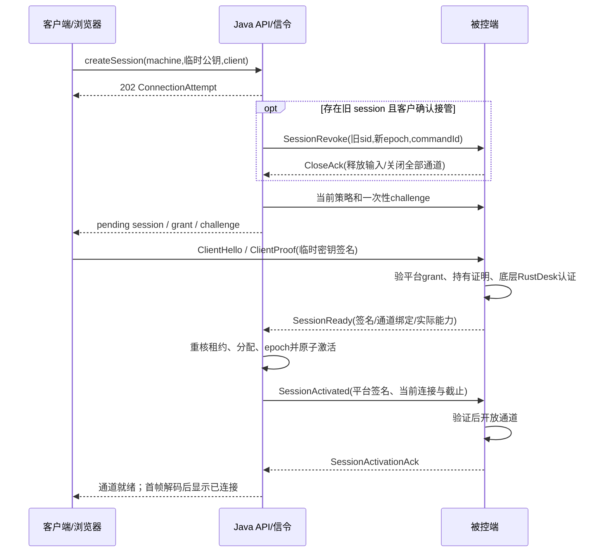

# 远控授权与设备消息实施规范

配套文件：[消息 Schema](../../backend/contracts/remote-signaling.schema.json)、[消息正反例](../../backend/contracts/remote-examples.json)、[HTTP API](../../backend/contracts/openapi.json)。它们约束生产协议；已有 Node／SQLite 参考编码不自动升级成此协议。本轮没有实现签名器、原生守卫或真实媒体适配器。

## 注册和身份建立

管理端批准资源及供应归属后，发放仅针对该 resource 的单次 enrollment token，工程默认有效十分钟，数据库存哈希。设备本机生成不可跨机器复用的管理密钥，发送 token、CSR、公钥持有证明和启动信息。注册服务核对 token／资源／供方绑定及 CSR 证明，原子消费 token 后签发设备证书，记录 deviceIdentityId、证书序列、密钥版本和有效期。

初始注册是 TLS＋单次 token／密钥证明；后续 API 必须 mTLS。不能要求一台尚未注册的电脑先拿已有设备证书，也不能信任 body 自报 supplierId。证书续签使用有效设备身份与新密钥持有证明；丢失密钥走受审核重新注册，撤销旧证书／epoch。反向代理传入的身份头必须由可信入口重建，拒绝公网伪造同名头。

## 线格式和签名

消息 Schema 校验的是 JWS 解码后的 JSON，不是允许裸 JSON 在网络上直接执行。线上使用标准 compact JWS；设备 HTTP 可用 `{jws:"..."}` 包装。受保护头固定 `alg=Ed25519`、`kid`、版本化 `typ`；拒绝 `none`、未知算法／曲线、远程 jku／x5u、重复 JSON 键、未知关键头和超长载荷。`kid` 只在预配置可信密钥集中查找，不能当 URL。

验证顺序：长度／语法 → 可信 key 和算法 → 签名 → 严格解码 Schema → 身份／audience → 时间 → 版本／epoch → challenge／sequence 重放 → 当前业务资格 → 原子消费。验证原始 JWS payload 字节，不先重新序列化再验签；跨语言签名测试使用固定相同字节。日志只记消息 ID、类型、版本、哈希及结果。

消息外层为 `messageType / messageId / sentAt / body`。serverTime、sentAt、业务截止为 UTC 毫秒；JWT grant 的 iat、nbf、exp 是秒。grant 的 exp 向下取整且设备另校验 leaseExpiresAtMs，不能用允许时钟偏差延长租期。工程初始时钟误差预算 2 秒；服务器／设备检测到不可信时间应停止新授权并修正，单调时钟用于已验证剩余期。该预算不是允许到期后再操作两秒。

每种 typ 独立验证用途：设备结果不能作为客户 grant，登录 token 不能作为远控授权。签名服务只接受已提交授权记录的 ID 和服务身份，不为任意调用者提交的 claims 直接签名。密钥轮换先发布新公钥，再签新 key；旧 key 仅保留到已发短授权失效，紧急撤销走策略版本／epoch 和外部隔离。

## 首次连接和接管顺序

`ConnectionAttempt` 是请求进度，不占第二个控制位。旧会话 `closing` 持续占位；只有可信 CloseAck 或独立带外隔离证明所有旧传输已失效，才释放。仅改数据库为 revoked 不释放。接管确认绑定旧 sid、epoch、expectedVersion、操作者和过期时间，原子消费；两次并发接管只能一个得到新控制位。

平台 grant 必须同时核对：tenant、account、deviceIdentityId、lease／allocation／assignment、各版本、authVersion、epoch、sid、jti、client key thumbprint、有效期与 capabilities。capabilities 是已审批的桌面功能，不能凭客户端声明增加文件／输入。jti 首次使用在设备持久化或权威授权端原子消费，同一次握手幂等重试关联同一 connectionId；不能让重试变成跨连接重放。

## 消息的处理条件

| 消息 | 发送方与可信前提 | 服务端／设备必须检查 | 允许改变的状态 |
| --- | --- | --- | --- |
| DeviceSyncRequest | 已注册设备、mTLS＋设备签名 | identity、boot、agentInstance、递增 sequence；activeSessions 仅报告事实 | 接收事实，不能由设备自报恢复旧租约 |
| DevicePolicySnapshot | 平台签名 | device、boot、policyVersion、当前绑定、serverTime、validUntil | 替换较旧策略；无有效分配则不得完整远控 |
| ClientHello | 当前授权客户端临时密钥签名 | sid、连接代次、grant.jti、设备与通道绑定 | 只开始握手，不能显示 active |
| ClientProof | 同一临时密钥 | 一次 challenge／nonce、cnf 指纹、双方通道身份、当前 epoch | 持有证明通过，不等于底层认证通过 |
| SessionReady | 设备签名 | RustDesk 认证、实际能力子集、绑定版本、当前资格、challenge | 提交逻辑授权active并写激活outbox；设备仍封锁通道 |
| SessionActivated / SessionActivationAck | 平台／设备签名 | activationId、当前连接代次、epoch、版本、截止、实际能力 | 设备收到有效平台激活后开放；回执后记录transportReadyAt，客户端再等首帧 |
| SessionRevoke | 平台签名 | commandId、sid、epoch、设备、原因 | 立刻停输入、释放按键、关所有通道；不退出远端应用 |
| CloseAck | 设备签名或独立隔离证据的专用处理器 | 当前 boot、connectionId、全部通道关闭、输入释放 | closing → closed；单纯超时不证明 closed |
| RenewGrant / RenewAck | 平台／设备分别签名 | 新 jti、challenge、策略及版本、实际应用截止 | 更新短授权；不改变电脑或 AI 商业期限 |
| AgentResult | 设备签名＋已交付命令 challenge | eventId、boot／实例、sequence、operation／command、预期版本、探针 | accepted／effect_reported／unknown；独立核验才 verified |

`SessionReady` 后端重核失败时必须向设备下发关闭；不能在设备已开通数据后只给客户端报错而留旧通道继续。激活前的媒体／输入保持封锁。每一条文件、剪贴板、声音和输入数据均受相同会话截止约束。

## 续租、失联和重连

工程初值：授权最长 30 秒，客户端每 10 秒续租；grant、设备本地计时和当前 leaseExpiresAt 取最小截止。续租须取得新一次 challenge 并提交持有证明；客户端拿不到新授权时最多维持已验证短授权的剩余时间。

正常续费／补时增加 leaseVersion；同一授权主体、分配和凭据不变时，旧 grant 可在旧截止内过渡到新版本，不能把每次版本增加都当撤权。禁用、换人、接管和到期才增加撤权 epoch。设备重启／恢复联网必须先拿新策略，不接受缓存策略自行恢复。

同一客户端短断线：保留临时私钥时申请 resume，原 sid、不同 connectionId、递增 generation；先封锁旧 generation，再开新通道。客户端丢失私钥或切账号：停止续租、重新创建 attempt；不得只拿旧 grant 文本续接。若服务端不能证明旧连接已停，仍走接管等待。

首次连接建立工程超时 20 秒、接管关闭提示阈值 10 秒；它们只触发失败／排查，不解除独占约束。返回稳定 failureCode，记录阶段耗时。未配置适配器直接 `ADAPTER_NOT_CONFIGURED`，不会加载本地演示兜底。

## 导出和设备命令

导出仅在专用 exportJob 范围内读白名单文件句柄，不共用完整桌面 grant。manifest 和各分块请求验证原使用者、保留期、jobVersion 和停止状态；导出服务主动中止到期流。分块与重试按 fileId／chunkIndex／hash 幂等，不因客户路径参数读取任意目录。需要 hash 的清单准备未结束时返回 preparing，不能交出未冻结的哈希。

设备动作按 kind 严格载荷：服务重启、OS 重启、改密、关闭会话、恢复镜像、验机；拒绝任意字符串命令。持久化 claimed 后只执行同一 operation 一次；unknown 不释放破坏性互斥。过期 queued 可拒绝；已经接单动作超时只标 unknown。由原 operationId 查询新实例／boot、实际凭据和镜像状态后收口。

设备纳管时记录哪些动作来自机内、哪些来自独立供方接口。外部隔离和重置也有 request／query／evidence；不能把 HTTP 200 或“已受理”记成实际完成。完整真机门槛见[端到端矩阵](09-end-to-end-matrix.md)。

## 受限凭据交付和确认令牌

改密命令只携带 credentialDeliveryId、目标版本和 challenge。命令目标设备经 mTLS 在有效窗口向凭据交付接口读取对应秘密；只允许该 identity／command／版本，响应 no-store、不记载荷日志、不进入普通幂等响应缓存。允许相同设备在同一有效操作内幂等重读，避免丢响应后被迫生成另一把密码；操作撤销／验收后立即失效。服务端秘密仍来自受控凭据库，不写明文数据库列。

设备命令解码 body 由 DeviceCommandPayload 按 kind 严格限制 payload。reset 只能选择获批 templateVersion／eraseScope／approvalEvidence；rotate 只能指定目标凭据版本及交付引用；重启不能附任意命令。heartbeat／poll／result 同样先验 JWS 再验具体 body；命令 envelope 的已签字段必须与轮询外层提示一致，外层不是信任源。

破坏性和接管确认携带 confirmationId＋confirmationToken。服务端只存 token 哈希，并绑定 actor、action、target、expectedVersion、旧 session／代际及截止，原子消费。签发接口本身不执行动作；前端必须展示影响后才提交执行，旧确认在状态改变后失效。

## 续租挑战、恢复接口及逻辑会话

`POST /sessions/{sid}/challenges` 接收 purpose=renew/resume、当前 connectionId 和 generation，验证当前账号、同一临时公钥、分配与电脑资格后签发短时 challenge。服务端保存随机 nonce 的哈希、purpose、sid、连接代次、epoch、截止及 consumedAt。challenge 只能在相应用途请求中原子消费，首次握手用过的 nonce 不能拿去续租。

`POST /sessions/{sid}/renew` 提交 challengeId、客户端签名 ClientProof、expectedConnectionGeneration。Proof 必须匹配 purpose=renew 及挑战绑定值。验证通过并提交授权记录后才签新 grant／发送 RenewGrant；设备验证应用后回 RenewAck，记录实际生效截止。RenewGrant 中的 deliveryChallengeId 是本次设备交付回执挑战，区别于已消费的客户端续租挑战；下一轮客户端仍通过 challenges 接口取新挑战。

`POST /sessions/{sid}/resume` 提交 purpose=resume 的证明、旧 connectionId、expectedGeneration。只对尚未结束且同密钥的逻辑会话受理；逻辑会话已closed／撤权则重新 create。受理返回 ConnectionAttempt；先以 scope=connection 关闭旧 transport 并取得对应 CloseAck，再递增 generation 创建新传输、签发新握手挑战，走 ClientHello／Proof、SessionReady、SessionActivated／Ack。scope=connection 的关闭不把逻辑sid改成closed；接管或整体撤权的 scope=session 则必须关闭全部传输。

逻辑会话和连接分别存表、分别有状态机。ConnectionAttempt.active 需要当前传输的激活回执；Session.active 只表示服务端已提交许可，单凭它不显示“桌面已连接”。任一阶段资格变化都递增撤权版本／epoch并关闭。激活 outbox 投递前重读当前代次和策略，设备拒绝已被更高 epoch／policyVersion取代的回执，重复 activationId 幂等。

未出租机器的 policy、命令和 AgentResult 统一用 leaseVersion=0、assignmentVersion=0、accountAuthVersion=0 表示不存在该绑定；有绑定时使用真实正版本。credentialVersion 从实际每机凭据版本起计，不虚构租约版本1。结果必须匹配原命令和当次可信快照；零值不授予客户远控资格。

## 控制面投递与待验证媒体协商

设备入站`agent/session-events`与出站`agent/poll.remoteEvents`的字段和幂等见[复核记录](11-review-and-personal-workspace.md)。首期可用mTLS长轮询，不依赖未实现的WebSocket隐式通道。它们只承载授权控制消息；实际浏览器SDP／ICE、编码及通道绑定需随原生适配器单独完成并真机验收，未完成前不把此文档当可运行媒体协议。
