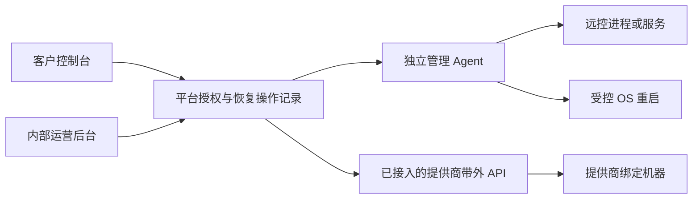

# Mac 长期运行后远控失联：上游调查与恢复方案

核查日期：2026-11-08。范围为 RustDesk OSS 客户端的长期在线可靠性与平台恢复能力；不展开内部运营后台 UI、卡或商品业务。

## 结论与证据边界

上游确实修复过与“Mac 长期保持远控会话”相关的内存持续增长问题：PR #15623 于 2026-07-20 合并，稳定版 **1.5.0 起包含修复，1.5.1 继续包含**。它修复的是显示元数据的 Objective-C 自动释放池缺失，不能据此认定用户遇到了端口占用或 socket 泄漏。[修复 PR](https://github.com/rustdesk/rustdesk/pull/15623)、[1.5.0 官方更新记录](https://github.com/rustdesk/rustdesk/releases/tag/1.5.0)。

用户确认的症状仅为：以前使用 RustDesk，Mac 长时间不关机、持续连接后无法再次连接，手动重启后恢复；不清楚重启的是 RustDesk 还是整机，没有明确端口报错。RustDesk/macOS 版本、受控端或控制端位置、实际持续时间、错误信息、故障时心跳和日志均未知。**目前无法确认用户的那次故障已经被上游修复，也无法定位它的根因。** 主需求文档中早先的“端口占用”记录应以这次澄清为准，本调查不修改主需求文档。

本次已验证官方发布元数据、相关 issue 的正文/评论/时间线、PR 合并状态、提交祖先关系及固定版本关键源码。未复现真实 Mac 故障，未构建或运行 RustDesk，未给实际电脑部署、升级或重启。独立契约与本地服务端/Agent 参考链路见 [device-health](../../backend/device-health/README.md)，不表示真实恢复执行器已经接入。

## 上游发布与相关故障

官方 latest release 是非预发布版 **1.5.1**，发布时间 2026-11-01，tag 指向 `23e5bb471a040d62f0a6ad52591fb30784265b73`。本调查将该提交作为固定基线，不能把 master、nightly 或尚未合并 PR 的状态混入稳定版结论。[发布页](https://github.com/rustdesk/rustdesk/releases/tag/1.5.1)、[latest 元数据](https://api.github.com/repos/rustdesk/rustdesk/releases/latest)、[tag 指向](https://api.github.com/repos/rustdesk/rustdesk/git/ref/tags/1.5.1)。

| 记录 | 实际症状与匹配程度 | 修复状态与版本 |
| --- | --- | --- |
| [#14603](https://github.com/rustdesk/rustdesk/issues/14603) / [PR #15623](https://github.com/rustdesk/rustdesk/pull/15623) | 受控 Mac 在多天/长会话中内存增长，部分用户报告变慢；与用户时间特征部分匹配，但未证明同一次“完全无法连接” | PR 已合并，修复 `BackingScaleFactor()` 缺 `@autoreleasepool`；有用户确认 nightly 改善。稳定 1.5.0 起包含，1.5.1 也包含；不能把 issue 原文关于重复连接、CLOSE_WAIT 等所有猜测都当成此 PR 已解决的问题 |
| [#16576](https://github.com/rustdesk/rustdesk/issues/16576) / [PR #16577](https://github.com/rustdesk/rustdesk/pull/16577) | 快速多次 Dock/Finder 打开导致多个主进程、僵尸子进程及 IPC 启动竞争；1.5.0 报告。需要特定打开行为，用户没有该证据 | 核查时 issue 和 PR 均 open、PR `merged=false`。不能作为稳定版已修复项，也未在本任务擅自合入该补丁 |
| [#15360](https://github.com/rustdesk/rustdesk/issues/15360) | 1.4.7 报告 root 服务与用户 `--server` 的 IPC 冲突/循环退出，包含明确 `os error 48`；用户没有这个报错，因此匹配弱 | issue 虽显示 closed/completed，时间线实际是 converted_to_discussion；没有关联修复证据。且 1.4.7 与固定 1.5.1 源码都将 root 服务 IPC 命名为 `_service`，与 `--server` 空后缀不同，报告者“二者同一路径”的根因解释不能照单采用 |
| [PR #16780](https://github.com/rustdesk/rustdesk/pull/16780) | 停服务再启动后不 Ready，以及 Mac 应用更新后 IPC 无法建立，需重启；触发是启停/更新，用户未确认该触发 | 2026-10-31 合并，提交 `3b7e2ceb...` 已包含在 1.5.1。不能推导为所有长期运行问题均修复；PR 自己还列出停服务后偶发崩溃待调查 |
| [PR #16564](https://github.com/rustdesk/rustdesk/pull/16564) / [#15605](https://github.com/rustdesk/rustdesk/issues/15605) | 控制端 Mac 睡眠/唤醒后旧会话冻结或需手动重连；与受控 Mac 长期不关机失联不同 | #16564 的发送超时修复仍 open、未合并；#15605 是转 discussion，不能称已修复 |
| [#16839](https://github.com/rustdesk/rustdesk/issues/16839) | 1.5.1 控制端 Mac 睡眠并切网后，画面和鼠标恢复但键盘无效，重启本地服务恢复；不等于整台受控 Mac 连不上 | closed 的时间线也是 converted_to_discussion，未发现关联修复；报告者的 stale socket 推测不是已验证结论 |
| [#15661](https://github.com/rustdesk/rustdesk/issues/15661) | macOS beta 连接同局域网自托管服务器失败，涉及本地网络隐私、`No route to host`；不是已证实的长期资源累积问题 | 被转 discussion，无可验证修复版本。本地网络许可、Screen Recording、Accessibility 必须分开检查，不能用重启替代首次授权 |

修复包含关系额外用 GitHub compare 验证：`5b4d6baf...` 是 [1.5.0 的祖先](https://api.github.com/repos/rustdesk/rustdesk/compare/5b4d6baf47283068fbe03f2eacd2ec34d0c20c2c...1.5.0)，也是 [1.5.1 的祖先](https://api.github.com/repos/rustdesk/rustdesk/compare/5b4d6baf47283068fbe03f2eacd2ec34d0c20c2c...1.5.1)，而 [1.4.9 不包含该提交](https://api.github.com/repos/rustdesk/rustdesk/compare/5b4d6baf47283068fbe03f2eacd2ec34d0c20c2c...1.4.9)。固定版本的 [`macos.mm`](https://github.com/rustdesk/rustdesk/blob/23e5bb471a040d62f0a6ad52591fb30784265b73/src/platform/macos.mm#L120) 也确有自动释放池。#14603 的用户确认见 [评论](https://github.com/rustdesk/rustdesk/issues/14603#issuecomment-5598066291)。

#16780 的提交同样是 [1.5.1 的祖先](https://api.github.com/repos/rustdesk/rustdesk/compare/3b7e2cebd9303a43eecb9bc96921548df846f45d...1.5.1)。各“转 discussion”的直接证据为 [#15360 时间线](https://api.github.com/repos/rustdesk/rustdesk/issues/15360/timeline)、[#15605 时间线](https://api.github.com/repos/rustdesk/rustdesk/issues/15605/timeline)、[#16839 时间线](https://api.github.com/repos/rustdesk/rustdesk/issues/16839/timeline)。

## 源码核查所得

- [`src/platform/macos.rs::start_os_service`](https://github.com/rustdesk/rustdesk/blob/23e5bb471a040d62f0a6ad52591fb30784265b73/src/platform/macos.rs#L858) 为 root 服务启动 `_service` IPC；[`src/server.rs::start_server`](https://github.com/rustdesk/rustdesk/blob/23e5bb471a040d62f0a6ad52591fb30784265b73/src/server.rs#L678) 为 `--server` 启动空后缀 IPC。后者启动失败会记录 occupied 并退出，但没有用户日志不能把该分支认作本次故障。
- [`src/ipc.rs::new_listener`](https://github.com/rustdesk/rustdesk/blob/23e5bb471a040d62f0a6ad52591fb30784265b73/src/ipc.rs#L699) 先做已有进程/路径检查再 bind。尚未合并的 #16577 指向这类竞争，需要复现后再决定是否单独采用补丁。
- [`rendezvous_mediator.rs::start_all`](https://github.com/rustdesk/rustdesk/blob/23e5bb471a040d62f0a6ad52591fb30784265b73/src/rendezvous_mediator.rs#L283) 有 ID 注册重试与手动重启通知；存在重试逻辑不代表长期运行一定自愈。`direct_server` 在直接访问 bind 失败后等待端口配置变化才重试，这个分支值得单独故障注入，但只有启用直接访问且确实出现 bind 失败时才相关；它不是用户故障的已确认原因。[直接访问实现](https://github.com/rustdesk/rustdesk/blob/23e5bb471a040d62f0a6ad52591fb30784265b73/src/rendezvous_mediator.rs#L1354)。
- [`connection.rs`](https://github.com/rustdesk/rustdesk/blob/23e5bb471a040d62f0a6ad52591fb30784265b73/src/server/connection.rs) 有连接关闭、RAII 连接集合清理、会话移除和发送超时等路径。这只能证明存在清理设计，不能由静态阅读证明没有泄漏，更不能从 issue 文字确认一定存在 socket 泄漏。
- 上游分别注册 [`RustDesk_server` LaunchAgent](https://github.com/rustdesk/rustdesk/blob/23e5bb471a040d62f0a6ad52591fb30784265b73/src/platform/privileges_scripts/agent.plist) 与 [`RustDesk_service` LaunchDaemon](https://github.com/rustdesk/rustdesk/blob/23e5bb471a040d62f0a6ad52591fb30784265b73/src/platform/privileges_scripts/daemon.plist)，都有自动启动/保活配置。进程退出可被拉起不等于进程卡死、注册失效或权限丢失能自愈。Fork 后必须使用实际安装的 bundle/服务标签，不能硬编码另一版本或另一应用的标签。

## 独立管理链路与状态

管理端专指内部运营后台；客户使用“客户控制台”。两端都通过各自认证入口调用平台控制面，客户权限不继承内部运营权限。客户主账号可以重启旗下电脑，子账号只能重启分配给自己的电脑；运营人员按独立权限及租户范围授权。重启权限不自动授予桌面访问权限。

Agent 与 RustDesk 分进程、分服务、分重启单元；控制面独立于 RustDesk ID/relay 服务。使用设备专属身份、受认证出站 HTTPS/mTLS、短时命令和受限特权 helper。它是内部设备运维通道，不增加面向客户的通用远程终端、任意命令或端口转发能力。管理链路仍共享宿主机与网络，不能被宣传成真正的带外能力。

建议每 15 秒心跳，45 秒无新心跳标记陈旧，120 秒标记不可达；时长是待验证的实施建议。时间以服务端接收与单调序列为准。状态分开保存，不能用一个“在线”灯代替：

| 维度 | 观测与含义 |
| --- | --- |
| 管理链路 | Agent 版本、启动身份、OS 启动身份、序列、最后心跳；不可达时仅说明失联，不判断为关机 |
| 远控本机 | 进程/服务启动身份、PID、运行时长、IPC 带超时应答；进程存在不代表可连接 |
| 远控网络 | ID 注册应答、relay 可达与 DNS/TLS/代理错误类别；记录最近变化，不把 ping 或端口通当作连接成功 |
| 桌面访问 | 登录用户/锁屏/睡眠与显示器状态，Screen Recording/Accessibility 授权可观测结果，受控访问探测；不能观测时标未知 |
| 资源趋势 | RustDesk 各进程内存/物理 footprint、FD 数、TCP 状态、监听归属、重启次数、进程重复数；比较趋势而非只看某次峰值 |
| 恢复操作 | requested、authorized、dispatched、accepted、效果已观察、桌面访问已验证、failed/rejected/unknown；接单不等于成功 |

访问探测不得抢占客户的单一远控会话，也不能绕过分配/有效期验证；实现前保留 unknown。开发任务是否完成独立于以上状态，不能把电脑在线或重新连上视为 Claude Code/Codex 任务成功。

## 三层恢复及前提

| 层级 | 可解决范围 | 必要前提、权限与完成判据 |
| --- | --- | --- |
| 1. 重启远控进程/服务 | RustDesk 退出、卡死、注册或 IPC 异常，独立 Agent 仍在线 | 预装 Agent、服务身份清楚、受限 helper 有服务控制权限；优先重启目标用户的远控 server，必要时明确选择 root helper。验证新进程身份及注册/访问恢复；不结束客户终端、开发任务或 OS 用户会话 |
| 2. 受控 OS 重启 | 远控服务重启无效、系统处于可执行管理命令但需重启的状态 | Agent 在线且持有 OS 重启权限；客户或运营人员明确确认会中断任务/会话；验证 OS boot identity 改变，再验证 Agent 和远控恢复。不能默认自动触发 |
| 3. 提供商带外重启/电源 | OS/Agent 卡死或公网链路断开，但托管商控制面仍可操作 | 平台供机已绑定提供商真实机器 ID，提供商确有对应独享机器重启/电源 API，凭据及权限已接入；记录提供商 operation ID，查真实结果并观察新 boot。仅 API 接单不能标为恢复。强制断电与正常 reboot 必须分别提供动作和中断提示 |

完整断网或整机挂死时，同一台机器上的 Agent、RustDesk 或客户网页都不能通过那条已经失联的链路让机器重启。只有已存在的独立带外通道、具备条件的其他运维入口或现场人员能处理。客户自带机器没有已授权带外能力时应显示“当前无法远程重启，需本地处理”，不能虚构恢复按钮有效。

整机重启还需验收加密预启动解锁、登录前服务、网络启动恢复、TCC 权限与无人值守接入。相关权限依据见 [RustDesk Mac 官方说明](https://rustdesk.com/docs/en/client/mac/)。不默认关闭加密或预存用户 OS 密码来换取重启可用性，具体设备能否无人值守重启必须在交付测试中确认。

恢复策略默认顺序是先观测、人工尝试远控服务恢复，再由有权操作者决定整机重启；任何层失败都不自动升级为整机或带外断电。可以后续增加仅远控进程的限频自愈，但需单独策略、重启预算、冷却期和审计；本次原型全部要求人工发起。

请求使用设备级恢复互斥、幂等键、30 秒内期限与 OS/进程启动身份条件，Agent 执行前再次检查。切换账号、设备回收或分配变化时重新授权并取消未执行命令。重启完成后不能自动恢复被撤销账号的旧会话。原有“新端确认接管旧端”只是终止控制连接，不触发以上任何重启，也不能停止开发任务。

## 复现与验证计划

首先在隔离测试 Mac 上确认安装版及系统版本，以固定 1.5.1 为产品基线；只有得到匹配日志/内存特征时，才用问题旧版对照验证 #15623。不要为复现而降级客户真实机器。

1. **长期运行**：Intel/Apple Silicon 及选定支持的 macOS，连续在线 7 天；覆盖单一长会话、长时间无会话、定时断开重连。记录进程身份、内存 footprint/压缩交换、FD、连接状态及注册时间。只看 RSS 会遗漏 #14603 一类压缩/交换中的累积内存。
2. **异常网络与会话**：断网、DNS/ID/relay 暂不可达、切换网络、睡眠唤醒、锁屏与显示器关闭分别测试；区分控制端与受控端。另测快速反复启动及服务启停，确认 #16576/#16780 路径是否出现。直接访问关闭/开启分别测 bind 失败，避免把默认 relay 失败归因于直接监听端口。
3. **业务连续性**：远端普通 OS 终端中运行带持续日志的模拟开发任务，网页关闭、换客户端、确认接管、网络断开与远控服务重启后，检查任务 PID/进度和日志仍推进。服务恢复不得 kill 用户终端或 OS 会话；OS/带外重启明确预期会中断。
4. **恢复故障注入**：只停止/挂起测试机 RustDesk，证明 Agent 仍在线并能请求远控恢复；让 Agent 失联，验证同链路操作拒绝；未接入提供商必须返回 not_configured。验证跨租户、子账号操作他人设备、过期命令、重复请求、分配变更和启动身份变化均拒绝或去重。
5. **真实完成判据**：进程重启有新启动身份、OS 重启有新 boot；访问恢复有真实连接验证；无足够证据保持 unknown。验证任务、恢复、桌面访问三者分别呈现，避免接单成功显示成机器已恢复。

发生问题时先保留现场，再决定恢复方式。每次故障最少记录：控制端/受控端、版本、最后正常时间、第一次失败时间、错误原文、所走线路、是否睡眠/切网/更新、分别重启 RustDesk 与整机的结果；补齐系统版本及硬件。现阶段不要求根任务打断逐题需求确认来获取这些信息。

测试 Mac 可用只读命令检查 `sw_vers`、`uptime`、`pgrep -fl 'RustDesk|/Contents/MacOS/service'`、目标 PID 的 `ps`/`lsof`/`vmmap -summary`/`footprint`，以及准确服务域和标签的 `launchctl print`。命令是否需要额外权限视系统而定；不无差别 kill 进程、不手工删除活跃 IPC、不批量重置权限。按进程启动时间对齐 RustDesk 用户日志、系统诊断日志和服务日志，脱敏设备 ID、IP、服务器地址和账号信息。

## 管理协议与可运行参考链路

新增 [协议约定](../../backend/device-health/protocol-v1.md) 和 `reference-runtime.cjs`、`reference-demo.cjs`。本地示例为虚构设备启动回环 HTTP 服务，服务端与 Agent 分别使用 SQLite 日志，完成签名握手、带会话身份和序列的心跳、短时受限命令、交付/接单、结果回报与去重。默认既无已注册设备也无已认证操作者，示例仅为验证流程临时配置身份。

设备请求与应答使用设备专属 HMAC，覆盖设备、用途、时间、nonce 和应答关联；服务端持久化拒绝重放。新 Agent 需凭上一会话 token 轮换身份，旧会话失效；握手丢失应答可由持久化握手 ID 恢复。心跳设备归属与接收时间由服务端确定，不信任设备发送的租户和时间。

命令派发前再次检查当前授权、分配版本、能力及启动身份；同 ID 同参数返回同操作，不同参数拒绝。Agent 只接收 `restart_remote/reboot_os`，先持久化 claim 再调用执行器；回报丢失只重传结果，崩溃/超时后结果不明不重执行。未交付过期记 expired，已交付后过期只能记 unknown，unknown 持续阻止第二次恢复。客户端时钟不单独决定命令寿命，参考实现使用签名服务端剩余 TTL 和请求开始时的本地单调时钟保守扣除往返耗时。

这验证了可复用协议/状态，不锁定最终技术栈。参考实现不安装守护服务、不执行 shell/重启/擦盘；示例使用虚构 boot 身份，真实 boot/进程/权限采集器未接入。设备 root 用户能够访问自己的 Agent 和密钥，因此签名心跳只证明持有设备身份，不提供对抗客户管理员的可信硬件证明。

## 租赁全生命周期与能力边界

最新业务要求为：客户可以自行操作系统；到期停止远控，仅允许导出；环境原样保留 3 天，之后清理并恢复最新基础环境。本节只落实技术依赖，不扩展卡、订阅资源或 AI 凭据分发。

客户拥有 OS 管理权限时，可以停掉 Agent、修改本机防火墙或安装其他远控。因此“禁用客户端”“停止 RustDesk 服务”“Agent 回报已停用”都不能等同强制隔离。产品层至少要在平台授权/受控网关拒绝新会话并撤销旧会话；严格仅导出还需要客户无法修改的提供商网络/虚拟化/电源边界和独立导出面。若保留公开直连、其他远控或任意出站网络，这一承诺无法由机内 Agent 保证。

| 生命周期能力 | 平台控制面/机内 Agent 能做的部分 | 必须具备的外部能力与真实验收 |
| --- | --- | --- |
| 接入与交付 | 收集 OS/硬件/服务信息，安装已批准远控和开发工具，做健康检查 | 独享资源及稳定机器 ID；真实网络、系统版本与登录前可达验收；客户不能获得提供商控制面凭据 |
| 到期停远控 | 平台拒绝连接票据，通知并终止自己控制的会话；Agent 可协助停本机服务 | 网关必须能断已有会话；直接 P2P/额外远控需外部网络隔离，不能只隐藏按钮。严格断流要验证现存 TCP/UDP/IPv6、VPN、第二网卡与出站隧道 |
| 仅导出 | Agent 在在线、有权限且文件可读时准备导出清单与文件；不能保证被用户停用/加密后仍能读全盘 | 独立受限导出 broker、只读快照/隔离盘挂载或事先准备的导出区；短时下载票据仅有导出权限，不开放桌面、shell、通用代理、写文件或任意网络 |
| 原样保留 3 天 | 记录到期/保留截止、暂停破坏性任务、保留已知文件和环境 | 客户可改 OS 时，可靠的磁盘保留依赖提供商快照/持久卷/独立备份或确认可用的完整保留手段。保留磁盘环境不等于冻结 RAM 或运行任务；在线写入也不是到期时刻的原样快照 |
| 保留期结束清理 | Agent 可清理特定已授权文件、撤销自身票据，提供辅助结果 | 全部用户卷/分区/快照/导出副本清单和真实擦除/重建能力；不能把删除用户目录当作整机重装。客户重装/破坏 Agent 后仍应可从外部重建 |
| 恢复最新基础环境 | Agent 在干净 OS 上执行固定版本 bootstrap，注册新设备身份，做软件与远控检查 | 提供商 reimage/重建 VM/恢复批准镜像 API，或已审核的独立恢复设施；绑定明确 OS image ID、基础环境版本和摘要，清理旧机器身份，独立验收后才回到可上架状态 |

三天保留期建议用服务端时间计算为到期后 72 小时，并与租期 revision 一起持久化；具体按自然日或精确时长仍须业务最终确认。租期恢复/续费与清理必须有事务互斥：清理尚未开始时可按新授权取消旧任务；擦盘已开始后不能承诺原环境可恢复。导出票据也绑定租期版本与保留截止，旧链接不能在重新出租后读取新用户文件。

“原样”是否要求到期时冻结任务/内存，或仅保留磁盘环境，尚未定义。本方案不擅自停机；如果采用停机/冻结一致性快照，会中断开发任务，必须作为明确业务策略。公开 EBS 快照只捕获已写盘数据，不保证应用缓存或 RAM，并建议对根卷快照先停机，不能据此承诺完整恢复运行中的开发任务。[AWS 快照说明](https://docs.aws.amazon.com/AWSEC2/latest/APIReference/API_CreateSnapshot.html)。

建议生命周期状态独立于健康灯：`active → expiry_restricting → export_only_retained → cleanup_due → resetting → validating → available`。外部隔离或导出准备未完成时停在 `expiry_restricting/blocked`，不能先标“仅导出”；擦除、镜像或验收没有真实结果时保持 resetting/blocked，不能重新上架。状态需要 `leaseRevision`、设备分配版本、操作 ID、目标卷/镜像清单和证据。该租期调度与导出/清理执行器尚未实现，不能把参考恢复队列当作已完成的租赁系统。

客户自带电脑不自动授权平台整机清盘；供应商提交机器也不意味着已有网络/电源/重装权限。缺少对应授权或外部能力的设备，只能诚实呈现能力缺口，不能按平台自有受管机器承诺自动隔离/重装。

## 供应商供机审核与公开 API 核查

供应商门户可以提交 Mac/Windows 硬件与准备好的资源，但本次不实现卡或 AI 凭据业务。硬件库存保存 `supplier_id` 与供应商机器引用；客户使用分配另存 `customer/tenant_id`、`account_id`、分配版本和租期。供应商管理权限默认不能进入客户桌面或发起客户机器恢复；参考授权已验证供应商身份仅凭所有权会被拒绝。平台运营的紧急维护授权、供应商物理/提供商权限以及客户远控权限属于不同边界，不能混成一个角色。

供方上架前需提交：稳定机器 ID 与 OS/硬件规格；提供商/机房归属；独立 Agent 安装与最小服务控制授权；外部网络隔离范围；电源/重启、镜像/全卷清理、任务查询 API 或替代受管恢复设施；凭据委托范围和吊销方式；可用基础镜像与 bootstrap；导出/保留手段；异步状态和失败处理。先在隔离测试资源上验收，能力通过后才启用相应按钮和交付承诺。只有一个可停用的机内 Agent 不满足强隔离与自动重装条件。

本次仅研究公开文档，未创建账户、测试凭据、调用资源动作或接入任何提供商。以下是可验证能力线索，均不是已选定供应商：

| 供机接口 | 文档确认存在的能力 | 对接条件与缺口 |
| --- | --- | --- |
| AWS EC2（Windows 与 Mac） | `RebootInstances`、按 AMI 启动新实例、EBS 快照；Windows 官方 AMI 为 Windows Server 系列，Mac 使用专享宿主 | 需要账户/区域/IAM、实例/宿主/卷清单、网络隔离设计及明确 AMI。Windows Server 不能自动当作 Win10/11 桌面规格；普通独立 VM 也不自动代表物理独享。Mac 最短宿主分配与清理时间需纳入交付，不把停止实例的宿主 scrub 等同删除全部 EBS/快照 |
| Scaleway Apple silicon | 公开 API 有 server reboot、reinstall、查询和 OS 列表；reinstall 会删除磁盘数据并恢复所选 OS 镜像默认配置 | 需 project/zone/server ID 与受限 API key；平台基础开发环境还要额外 bootstrap。独立网络隔离、只读导出、完整保留/快照与清理完成证据需另外验收，不能从有 reinstall API 推断全部具备 |
| MacStadium | 官方公开 server list/status、开/关机/reboot API，支持 Bearer token；状态包括电源与重启状态 | 必须确认具体账户/机器支持和委托权限；这份 API 文档没有证明网络隔离、完整镜像恢复或导出能力。动作是 GET，有副作用，适配器禁止自动预取/盲目重试；返回 True 不能证明客户桌面已恢复 |

直接来源：[EC2 RebootInstances](https://docs.aws.amazon.com/AWSEC2/latest/APIReference/API_RebootInstances.html)、[RunInstances](https://docs.aws.amazon.com/AWSEC2/latest/APIReference/API_RunInstances.html)、[Windows AMI](https://docs.aws.amazon.com/ec2/latest/windows-ami-reference/)、[Mac 停止/宿主清理](https://docs.aws.amazon.com/AWSEC2/latest/UserGuide/mac-instance-stop.html)、[Scaleway Apple silicon API](https://www.scaleway.com/en/developers/api/apple-silicon)、[reinstall 语义](https://www.scaleway.com/en/developers/cli/apple-silicon)、[MacStadium API](https://api.macstadium.com/core/api/)。

AWS 文档特别说明修改安全组规则不会立即中断已被跟踪的连接；需要立即断流时可用无状态网络 ACL 等机制，仍要根据设备所在子网、管理/导出例外和 IPv6 实测，避免影响其他租户。这是“禁用入口不能等同强隔离”的具体例子。[连接跟踪说明](https://docs.aws.amazon.com/AWSEC2/latest/UserGuide/security-group-connection-tracking.html)。

提供商能力示例已记录在 [provider-capabilities.example.json](../../backend/device-health/provider-capabilities.example.json)，所有适配器保持 `configured: false`，没有伪造机器 ID、成功回执或可用凭据。

## 本次交付与尚未完成

已新增独立 `health-contract.cjs`：多维健康判断、主/子账号与内部运营授权边界、恢复能力和在线前提检查、期限与启动身份约束、任务中断确认、真实接单回执及新心跳效果验证。默认适配器明确未接入，适配器异常显示 unknown，不制造成功状态。

本机运行 `node --test backend/device-health/health-contract.test.cjs backend/device-health/reference-runtime.test.cjs`：**20 项测试通过**。除原契约边界外，覆盖真实回环 HTTP、消息篡改/重放、旧 Agent 会话、心跳时间和序列、SQLite 重新打开后的命令幂等、派发重授权、交付超时、结果丢失重传、Agent 中断后不重复执行、执行器超时和握手丢失应答恢复。所有执行器测试均为测试回调，没有系统副作用；不包含真实 Mac、RustDesk 或提供商 API。

尚未完成：用户故障定位、Mac 复现与长期稳定性实测、真实 Agent 采集/特权执行器、生产身份/证书/API 与确认令牌、分布式队列/完整审计、实际提供商接入、独立访问验证、租期调度、强隔离、仅导出与清理/镜像恢复执行器。上述能力接入前不可宣称管理端已能恢复或重装真实机器。现有运行路径未改动；本次回归面仅为新增独立参考模块及原契约导出授权函数，未修改上游 RustDesk 或现有商城逻辑。
